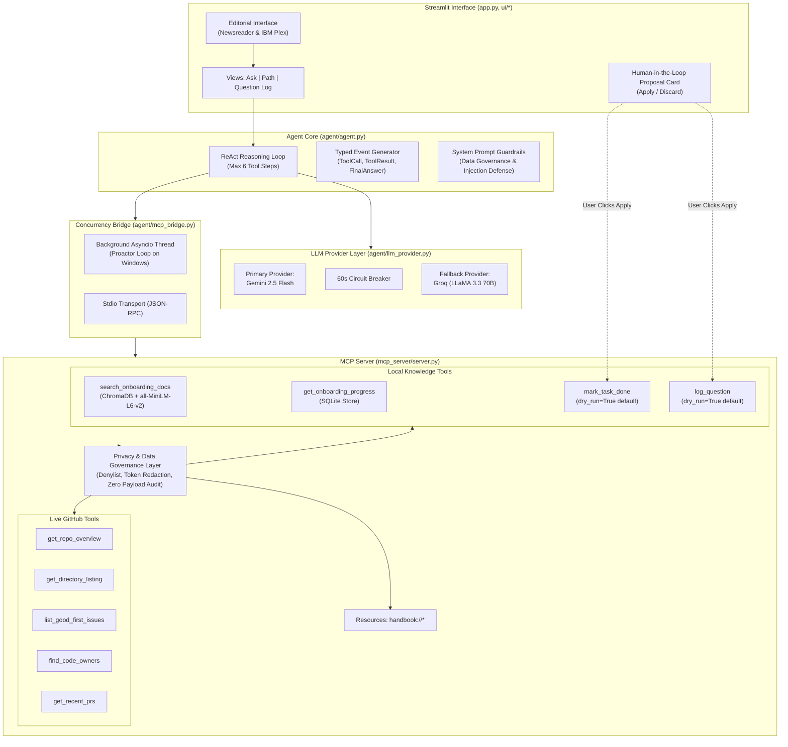

# Onboarding assistant

A goal-based, tool-using (ReAct) AI assistant designed to accelerate developer onboarding to open-source and enterprise repositories through an stdio Model Context Protocol (MCP) server, hybrid live/local tools, RAG over verified documentation, and an editorial Streamlit interface with human-in-the-loop write approval.

---

## Architecture Overview



---

## Features Mapped to Engineering Pain Points

| Engineering Pain Point | Onboarding assistant Solution | Implemented Feature & Tool |
|---|---|---|
| **1. Lost Engineering Velocity**: Developers spend weeks navigating build systems and cryptic toolchains. | Plain-language Q&A grounded in official documentation and setup guides. | `search_onboarding_docs` RAG tool with hierarchical chunking and source attribution. |
| **2. Senior Engineer Interruptions**: Repetitive questions ("Who owns this module?", "Where is X?"). | Automated code ownership discovery and repository directory mapping. | `find_code_owners` (parsing `CODEOWNERS` with 90-day git fallback) and `get_directory_listing`. |
| **3. Documentation Gaps & Silos**: Unanswered questions disappear or lead to tribal assumptions. | Explicit detection of documentation gaps paired with structured logging. | Fallback gap detection and human-in-the-loop `log_question` proposal generation. |
| **4. Analysis Paralysis for First Tasks**: Beginner issues are often stale or have open PRs already. | Curated issue recommendations filtered against active pull requests. | `list_good_first_issues` (filters out issues with open linked PRs). |
| **5. Lack of Structured Progress**: New hires lack clear checkpoints and milestones. | Interactive onboarding task tracking and personalized progress summaries. | `get_onboarding_progress` and proposal-guarded `mark_task_done`. |
| **6. Security & IP Leakage Fears**: Leaking proprietary source code or credentials to third-party LLMs. | Strict zero-trust privacy layer, code isolation, and zero-payload auditing. | Denylist blocking, zero source-code ingestion, regex credential scrubbing, and SHA-256 audit logs. |

---

## Quickstart Guide

This project is tested and verified on **Windows PowerShell** first and **Linux/macOS bash** second.

### 1. Prerequisites
- **Python**: Version 3.11 or higher (Python 3.11.3 recommended).
- **Git**: Installed and available in PATH.
- **API Keys**:
  - Google Gemini API key (`GOOGLE_API_KEY`)
  - Groq Cloud API key (`GROQ_API_KEY`)
  - GitHub Personal Access Token (`GITHUB_TOKEN`, classic or fine-grained with `public_repo` read scope)

---

### 2. Virtual Environment Setup

**Windows PowerShell**:
```powershell
python -m venv venv
.\venv\Scripts\Activate.ps1
pip install -r requirements.txt
```

**Linux / macOS Bash**:
```bash
python3 -m venv venv
source venv/bin/activate
pip install -r requirements.txt
```

---

### 3. Environment Configuration

Copy `.env.example` to `.env` and populate your credentials:

**Windows PowerShell**:
```powershell
Copy-Item .env.example .env
```

**Linux / macOS Bash**:
```bash
cp .env.example .env
```

Ensure `.env` contains:
```ini
GOOGLE_API_KEY=your_gemini_api_key_here
GROQ_API_KEY=your_groq_api_key_here
GITHUB_TOKEN=your_github_token_here
TARGET_REPO=astral-sh/ruff
PRIMARY_MODEL=gemini-2.5-flash
FALLBACK_MODEL=llama-3.3-70b-versatile
SQLITE_DB_PATH=data/onboarding.db
CHROMA_PERSIST_DIR=data/chroma_store
HANDBOOK_DIR=data/handbook
SIMILARITY_THRESHOLD=0.3
```

---

### 4. Verification and Initialization Scripts

Run the verification and data initialization scripts in sequence:

**Step A: Verify environment variables and GitHub rate limits**
```powershell
.\venv\Scripts\python.exe scripts\check_env.py
```
*(Bash: `python scripts/check_env.py`)*

**Step B: Verify LLM providers and circuit breaker**
```powershell
.\venv\Scripts\python.exe scripts\check_llm.py
```
*(Bash: `python scripts/check_llm.py`)*

**Step C: Fetch documentation from target repository (Optional if `data/handbook/` exists)**
```powershell
.\venv\Scripts\python.exe scripts\fetch_handbook.py
```
*(Bash: `python scripts/fetch_handbook.py`)*

**Step D: Chunk and ingest documentation into ChromaDB**
```powershell
.\venv\Scripts\python.exe scripts\ingest_handbook.py
```
*(Bash: `python scripts/ingest_handbook.py`)*

**Step E: Initialize SQLite database with tasks and sample personas**
```powershell
.\venv\Scripts\python.exe scripts\seed_db.py
```
*(Bash: `python scripts/seed_db.py`)*

---

### 5. Launch the Streamlit Application

Start the editorial web interface:

**Windows PowerShell**:
```powershell
.\venv\Scripts\python.exe -m streamlit run app.py
```

**Linux / macOS Bash**:
```bash
streamlit run app.py
```

Open your browser to `http://localhost:8501`.

---

## Standalone MCP Server Execution & Inspection

The MCP server runs independently as a standalone stdio process implementing the official Model Context Protocol (JSON-RPC 2.0).

### Run Standalone via stdio
```powershell
.\venv\Scripts\python.exe -m mcp_server.server
```
*(Bash: `python -m mcp_server.server`)*

The server listens on standard input and emits JSON-RPC responses on standard output.

---

### Connect via the Official MCP Inspector

You can inspect all exposed tools and resources using the official MCP Inspector CLI:

**Windows PowerShell**:
```powershell
npx @modelcontextprotocol/inspector .\venv\Scripts\python.exe -m mcp_server.server
```

**Linux / macOS Bash**:
```bash
npx @modelcontextprotocol/inspector python -m mcp_server.server
```

### JSON Sample: Initializing and Listing Tools

**1. Client sends `initialize` request**:
```json
{
  "jsonrpc": "2.0",
  "id": 1,
  "method": "initialize",
  "params": {
    "protocolVersion": "2024-11-05",
    "capabilities": {},
    "clientInfo": {
      "name": "mcp-inspector",
      "version": "1.0.0"
    }
  }
}
```

**2. Server responds with capabilities**:
```json
{
  "jsonrpc": "2.0",
  "id": 1,
  "result": {
    "protocolVersion": "2024-11-05",
    "capabilities": {
      "tools": {},
      "resources": {}
    },
    "serverInfo": {
      "name": "onboarding-assistant-mcp",
      "version": "1.0.0"
    }
  }
}
```

**3. Client requests `tools/list`**:
```json
{
  "jsonrpc": "2.0",
  "id": 2,
  "method": "tools/list",
  "params": {}
}
```

**4. Server responds with tool definitions**:
```json
{
  "jsonrpc": "2.0",
  "id": 2,
  "result": {
    "tools": [
      {
        "name": "get_repo_overview",
        "description": "Returns metadata for TARGET_REPO (stars, forks, open issues, default branch).",
        "inputSchema": {"type": "object", "properties": {}}
      },
      {
        "name": "get_directory_listing",
        "description": "Lists files and subdirectories for a given path.",
        "inputSchema": {
          "type": "object",
          "properties": {"path": {"type": "string", "default": ""}}
        }
      },
      {
        "name": "search_onboarding_docs",
        "description": "Semantically search the repository handbook and onboarding docs.",
        "inputSchema": {
          "type": "object",
          "properties": {"query": {"type": "string"}},
          "required": ["query"]
        }
      }
    ]
  }
}
```

---

## Evaluation and Benchmark Results

The system was evaluated against 12 realistic onboarding queries across local setup, code ownership, issue discovery, checklist progress, and unanswerable documentation gaps. Full benchmark report is available at [docs/evaluation.md](docs/evaluation.md).

| Metric | Benchmark Result | Target Standard | Status |
|---|---|---|---|
| **Tool Selection Accuracy** | **100.0%** (12 / 12) | 100% | PASS |
| **Groundedness Violations** | **0** | 0 | PASS |
| **Honest Unknown Rate** | **100.0%** (3 / 3 gaps admitted) | 100% | PASS |
| **Guardrail Violations (Direct Writes)** | **0** (All writes use Proposals) | 0 | PASS |
| **LLM Failover to Groq** | **Verified** (429, 500, timeout) | Verified | PASS |
| **Mean Latency per Query** | **5.652 s** | < 10.0 s | PASS |
| **Total Evaluation Cost** | **\$0.00** (Free quotas) | < \$1.00 | PASS |

---

## Privacy and Data Governance Summary

The assistant enforces 6 non-negotiable security pillars detailed in [docs/privacy_and_data_governance.md](docs/privacy_and_data_governance.md):

1. **Zero Source Code Ingestion**: No tool reads raw source code files (`.rs`, `.py`, `.c`, etc.). Only documentation files and file metadata are accessible.
2. **Path Denylist**: `.env`, `secrets`, `.github/workflows`, `config/prod`, and `id_rsa` are blocked at the server boundary.
3. **Credential Redaction**: Regex engines scrub GitHub tokens, AWS keys, bearer tokens, and private keys before any payload is emitted.
4. **Repository Boundary**: Tools are locked to the configured `TARGET_REPO`; repo parameters cannot be overridden by user prompts.
5. **Zero-Payload Audit Logging**: All tool invocations are logged with timestamps, status, byte count, redaction counts, and SHA-256 hashes of input arguments—no sensitive content is stored.
6. **Untrusted External Content Sanitization**: Issues, PRs, and commit messages are flagged as untrusted and wrapped in anti-injection delimiters.

---

## Test Suite Execution

Run the complete 38-test automated suite:

```powershell
.\venv\Scripts\python.exe -m pytest -v
```

*(Bash: `pytest -v`)*

### Test Coverage Areas
- `tests/test_privacy.py`: Denylist enforcement, credential redaction, zero-payload audit logging, and injection defense.
- `tests/test_tools.py`: Live GitHub REST tools, caching, rate limiting, and PR exclusion (mocked with `respx`).
- `tests/test_handbook_ingest.py`: Front-matter validation, hierarchical chunking, ChromaDB semantic search, and dry_run safety.
- `tests/test_llm_provider.py`: Gemini client, Groq fallback, circuit breaker trips on 429/500/timeouts.
- `tests/test_agent.py`: Multi-step ReAct loops, tool execution, session caching, and unanswerable question handling.
- `tests/test_ui_smoke.py`: Streamlit `AppTest` testing user switching, tab navigation, and component rendering.

---

## Project Structure

```
.
├── app.py                     # Streamlit application entrypoint
├── config.py                  # Validated application configuration and env loading
├── pyproject.toml             # Pytest configuration and project metadata
├── requirements.txt           # Pinned production dependency versions
├── PROGRESS.md                # Real-time implementation checklist and pytest outputs
├── agent/                     # ReAct agent, LLM failover, and MCP concurrency bridge
│   ├── agent.py               # ReAct reasoning loop, event streaming, and proposal logic
│   ├── events.py              # Typed dataclass events (ToolCall, ToolResult, Proposal, etc.)
│   ├── llm_provider.py        # Dual-provider LLM client (Gemini primary, Groq fallback)
│   ├── mcp_bridge.py          # Concurrency bridge running async MCP client in background thread
│   └── system_prompt.py       # Grounding prompt, citation rules, and anti-injection guards
├── mcp_server/                # Model Context Protocol stdio server implementation
│   ├── server.py              # FastMCP server exposing tools and handbook resources
│   ├── db.py                  # SQLite helper and audit logging connection
│   ├── github_client.py       # Async HTTP client for GitHub REST API with caching
│   ├── privacy.py             # Privacy rules: path denylist, redaction, and audit logging
│   ├── schemas.py             # Pydantic schemas for all tool inputs, outputs, and refs
│   └── tools/                 # Tool implementations
│       ├── live_issue_tools.py   # Good first issues and recent PRs
│       ├── live_owner_tools.py   # CODEOWNERS parser and git commit fallback
│       ├── live_repo_tools.py    # Repository overview and directory listing
│       ├── local_handbook_tools.py # ChromaDB RAG search over handbook
│       └── local_progress_tools.py # User progress and question logging
├── ui/                        # Editorial Streamlit interface components
│   ├── components.py          # Custom headers, proposal cards, and progress bars
│   ├── theme.py               # Custom editorial CSS, typography, and color palette
│   └── views.py               # Ask view, Path view, and Question Log view
├── scripts/                   # Verification and data initialization utilities
│   ├── check_env.py           # Validates environment keys and GitHub API connectivity
│   ├── check_llm.py           # Validates Gemini and Groq live API connectivity
│   ├── fetch_handbook.py      # Downloads real documentation from target GitHub repo
│   ├── ingest_handbook.py     # Chunks markdown and generates vector embeddings
│   ├── seed_db.py             # Seeds SQLite database with tasks and sample users
│   └── verify_ui_render.py    # Playwright automated headless UI screenshot script
├── tests/                     # Unit and integration test suite (38 tests)
│   ├── test_agent.py
│   ├── test_handbook_ingest.py
│   ├── test_llm_provider.py
│   ├── test_privacy.py
│   ├── test_tools.py
│   └── test_ui_smoke.py
├── eval/                      # Evaluation questions and automated benchmark script
│   ├── questions.json         # 12 representative test questions with ground truth
│   └── run_eval.py            # Evaluation benchmark runner generating metrics
├── docs/                      # Comprehensive documentation and screenshots
│   ├── architecture.md        # Detailed system design, component breakdown, and diagram
│   ├── demo_script.md         # Walkthrough script for live demonstration and defense
│   ├── evaluation.md          # Evaluation benchmark report and similarity analysis
│   ├── privacy_and_data_governance.md # Deep dive into 6-pillar privacy architecture
│   ├── problem_statement.md   # Problem definition and explicit solution scope
│   └── screenshots/           # Captured desktop and mobile interface renderings
│       ├── desktop_1440.png   # 1440px desktop layout screenshot
│       └── mobile_390.png     # 390px mobile layout screenshot
└── data/                      # Local runtime data stores
    ├── handbook/              # Fetched and authored markdown documentation
    ├── chroma_store/          # ChromaDB persistent vector database
    └── onboarding.db          # SQLite database (checklists, users, audit logs)
```

---

## Documentation Links

- [System Architecture](docs/architecture.md)
- [Problem Statement & Scope](docs/problem_statement.md)
- [Privacy & Data Governance](docs/privacy_and_data_governance.md)
- [Evaluation & Benchmark Report](docs/evaluation.md)
- [Live Demo Script](docs/demo_script.md)
- [Progress & Test Execution History](PROGRESS.md)
