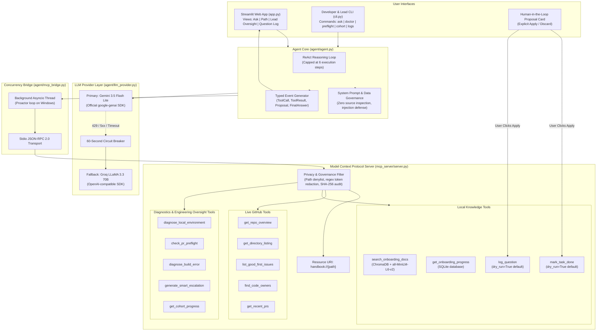

# Onboarding Assistant

A goal-based, tool-augmented (ReAct) AI developer assistant designed to eliminate onboarding friction for software engineers joining enterprise and open-source repositories. Grounded on an official Model Context Protocol (MCP) stdio server, dual-provider LLM failover, semantic RAG over repository documentation, an editorial Streamlit web interface, and a developer-first CLI with human-in-the-loop write approval.

---

## What is this Project?

When a software engineer joins an active, complex codebase (benchmarked here on [Astral's Ruff](https://github.com/astral-sh/ruff) — a high-performance Python linter and formatter written in Rust), they face steep challenges:
- **Environment setup friction**: Setting up Cargo workspaces, Python virtual environments, and local toolchains is cryptic and error-prone.
- **Maintainer fatigue**: Senior developers spend hours answering repetitive questions (*"Where does the parser live?", "Who owns the linter crate?"*).
- **Task paralysis**: Newcomers struggle to identify good-first-issues that are truly unassigned rather than already claimed in an active pull request.
- **Documentation gaps & tribal knowledge**: Out-of-date docs leave engineers stranded, leading to guesswork or stalled velocity.

The **Onboarding Assistant** acts as a 24/7 AI onboarding mentor directly embedded in the repository:
1. **Live Ground Truth**: Live GitHub REST tools inspect current repository state (issues, PRs, directory structures, code owners) without reading proprietary source code.
2. **Verified Knowledge RAG**: ChromaDB semantic vector search retrieves authoritative guidance from the repository handbook with strict citation attribution.
3. **Human-in-the-Loop Safety**: State-modifying actions (such as logging documentation gaps or marking onboarding checklist milestones) are presented as proposed changes requiring explicit user confirmation before execution.
4. **Resilient Dual-Provider LLM Core**: Automatic 60-second circuit breaker transitions seamlessly from Google Gemini (primary) to Groq LLaMA 3.3 70B (fallback) upon 429 quota exhaustion, 5xx outages, or timeouts.
5. **Multi-Interface Access**: Accessible via a clean Streamlit web interface (`app.py`), a terminal CLI (`cli.py`), or as an independent Model Context Protocol stdio server for IDE integrations.

---

## 3-Minute Fast Track for Reviewers

If you already have Python 3.11+ installed and want to run the project immediately:

```bash
# 1. Clone the repository
git clone https://github.com/PS-Divya-Rajput/onboarding-assistant_L2_project.git
cd onboarding-assistant_L2_project

# 2. Create and activate virtual environment
python -m venv venv
# Windows PowerShell: .\venv\Scripts\Activate.ps1
# macOS / Linux Bash: source venv/bin/activate

# 3. Install dependencies
pip install -r requirements.txt

# 4. Copy environment template and add your API keys
# Windows PowerShell: Copy-Item .env.example .env
# macOS / Linux Bash: cp .env.example .env

# 5. Initialize and seed SQLite database with sample personas and milestones
python scripts/seed_db.py

# 6. Launch the Streamlit web application
streamlit run app.py
```
Open your browser to `http://localhost:8501`.

---

## Prerequisites & Required API Keys

### 1. System Requirements
- **Python**: Version 3.11 or higher (developed and verified on Python 3.11.3).
- **Git**: Installed and available in your system PATH.
- **OS**: Windows 10/11 (PowerShell), macOS, or Linux (bash).

### 2. Free API Keys
You will need 3 free API keys configured in `.env`. None of them require a paid plan or credit card:

| Key | Purpose | How to Get (100% Free) |
|---|---|---|
| `GOOGLE_API_KEY` | Primary LLM provider (Gemini 3.5 Flash Lite) | Get instantly from [Google AI Studio](https://aistudio.google.com/app/apikey) |
| `GROQ_API_KEY` | Fallback LLM provider (LLaMA 3.3 70B) for instant failover | Get instantly from [Groq Cloud Console](https://console.groq.com/keys) |
| `GITHUB_TOKEN` | Live GitHub REST API inspection of repository metadata | Create a classic token at [GitHub Settings > Tokens](https://github.com/settings/tokens) (select `public_repo` read scope) |

---

## Complete Step-by-Step Setup Guide

Follow this guide to install and configure everything on your PC.

### Step 1: Clone the Repository

**Windows PowerShell / macOS / Linux**:
```bash
git clone https://github.com/PS-Divya-Rajput/onboarding-assistant_L2_project.git
cd onboarding-assistant_L2_project
```

---

### Step 2: Create and Activate a Virtual Environment

**Windows PowerShell**:
```powershell
python -m venv venv
.\venv\Scripts\Activate.ps1
```
> *PowerShell Tip*: If you encounter `running scripts is disabled on this system`, run this once in your current PowerShell session:
> ```powershell
> Set-ExecutionPolicy -Scope Process -ExecutionPolicy Bypass
> ```

**macOS / Linux Bash or Zsh**:
```bash
python3 -m venv venv
source venv/bin/activate
```

Verify your active Python path:
```bash
python --version   # Should show Python 3.11.x
```

---

### Step 3: Install Required Packages

Install all pinned production dependencies:

```bash
pip install -r requirements.txt
```

---

### Step 4: Configure Environment Variables

Create your `.env` configuration file from `.env.example`:

**Windows PowerShell**:
```powershell
Copy-Item .env.example .env
```

**macOS / Linux Bash**:
```bash
cp .env.example .env
```

Open `.env` in any text editor and fill in your keys:

```ini
GOOGLE_API_KEY=your_gemini_api_key_here
GROQ_API_KEY=your_groq_api_key_here
GITHUB_TOKEN=your_github_token_here
TARGET_REPO=astral-sh/ruff
GEMINI_MODEL=gemini-3.5-flash-lite
GROQ_MODEL=llama-3.3-70b-versatile
LLM_TIMEOUT_SECONDS=20
MAX_TOOL_STEPS=6
SIMILARITY_THRESHOLD=0.30
GOOD_FIRST_LABELS=good first issue,good-first-issue,help wanted
PATH_DENYLIST=.env,secrets,.github/workflows,config/prod,id_rsa
```

---

### Step 5: Run Verification and Database Seeding Scripts

Run the verification scripts in sequence to ensure your environment, network, and database stores are ready:

#### A. Validate Environment Keys and GitHub API Access
```bash
python scripts/check_env.py
```
*Verifies `.env` keys, GitHub token authentication, core rate limits, and access to `astral-sh/ruff`.*

#### B. Validate LLM Providers (Gemini & Groq)
```bash
python scripts/check_llm.py
```
*Verifies live API connectivity, text generation, and forced tool-calling for both Gemini and Groq.*

#### C. Initialize and Seed the SQLite Database
```bash
python scripts/seed_db.py
```
*Initializes database tables in `data/onboarding.db` and seeds 12 handbook milestones, 3 realistic developer personas (`user_ravi`, `user_elena`, `user_marcus`), and sample question history.*

> **Pre-Ingested Documentation Note**: The ChromaDB vector database (`data/chroma_store/`) and markdown handbook documents (`data/handbook/`) are already bundled in the repository. You do **not** need to re-download or re-embed documentation to run the project. If you ever want to re-fetch and re-embed fresh docs from GitHub, you can optionally run:
> ```bash
> python scripts/fetch_handbook.py
> python scripts/ingest_handbook.py
> ```

---

### Step 6: Launch the Streamlit Web Application

Start the web application:

```bash
streamlit run app.py
```

The application will launch in your browser at `http://localhost:8501`.

---

## Exploring the Web Application

The Streamlit UI uses an editorial aesthetic (warm paper background, Newsreader and IBM Plex typography, zero emojis) designed to feel like an authoritative engineering documentation portal.

### 1. Left Sidebar Navigation
- **Workspace Header**: Displays target repository (`astral-sh/ruff`) and active branch (`main`).
- **Developer Persona Selector**: Switch between 3 realistic developer profiles to see personalized views:
  - `Ravi Patel (Junior Contributor)`: On step 3 of his onboarding roadmap.
  - `Elena Rostova (Backend Engineer)`: Intermediate onboarding stage.
  - `Marcus Chen (Systems Programmer)`: Advanced stage contributor.
- **Milestone Progress Bar**: Segmented progress indicator reflecting completed tasks out of 12.
- **Next Milestone Card**: Highlights the user's immediate next task with an *"Ask about next step"* one-click shortcut.
- **Knowledge Base Telemetry**: Displays the count of indexed documentation sections (13 docs, 277 sections).
- **Data Governance Guarantee**: Confirms zero source-code leakage and AST-only inspection.

### 2. Top Navigation Tabs

#### Tab 1: Ask (Interactive AI Mentor)
- Natural language developer Q&A interface.
- Includes one-click suggested starter prompts (Local Setup, Environment Doctor, PR Pre-Flight, Code Ownership).
- Displays real-time ReAct execution traces showing tool names, execution duration (e.g. `0.2s`), and tool origin (`local` vs `live`).
- Provides verified source citation chips `[S1] · CONTRIBUTING.md` with direct permalinks.
- **Human-in-the-Loop Proposal Card**: When a write action is requested (such as marking a milestone done or logging a question), an amber proposal card renders with **Apply** and **Discard** buttons. No database changes happen until the human clicks Apply!

#### Tab 2: Path (12-Milestone Onboarding Roadmap)
- Visual milestone roadmap tailored to the active developer persona.
- Filter milestones by *All*, *To do*, or *Completed*.
- Each milestone has an *"Ask about this step"* button that immediately prompts the AI assistant for step-by-step guidance.

#### Tab 3: Lead Oversight (Engineering Manager Dashboard)
- Team-wide velocity overview for engineering leads.
- High-level metrics: Cohort average completion percentage and count of stalled engineers (< 4 steps completed).
- Developer progress matrix showing milestone statuses across all team members.
- Cohort bottleneck detection showing where developers are getting stuck.
- Senior escalation packet inspector.

#### Tab 4: Question Log (Documentation Gap Radar)
- Chronological log of onboarding questions submitted by developers.
- Filter by *All questions*, *Answered from handbook*, or *Gaps in handbook*.
- Unresolved questions highlight documentation gaps for maintainers to write new documentation for.

---

## Hands-On Reviewer Scenarios (Test Drive)

To experience the full capabilities of the system, try these 5 representative test scenarios in the **Ask** tab of the web interface:

### Scenario 1: Local Setup & Grounded Documentation RAG
- **Copy & Paste Prompt**:
  > *"How do I set the project up locally and build Ruff?"*
- **What to Observe**:
  1. The agent executes `search_onboarding_docs(query="setup prerequisites")`.
  2. The trace summary shows: `01 search_onboarding_docs local 0.2 s`.
  3. The answer provides exact prerequisites: installing the Rust toolchain, installing `uv`, and building with `cargo run -p ruff -- check <file> --no-cache`.
  4. The answer cites `[S1]`, pointing to `CONTRIBUTING.md > The Basics > Prerequisites` with a direct permalink.

---

### Scenario 2: Component Architecture & Code Ownership
- **Copy & Paste Prompt**:
  > *"Where is the Python parser code located and who should I ask for review?"*
- **What to Observe**:
  1. Multi-step reasoning: Agent calls `get_directory_listing(path="crates")`, then calls `find_code_owners(path="crates/ruff_python_parser")`.
  2. The answer explains that the parser crate is located in `crates/ruff_python_parser` and that designated code owners are `@MichaReiser` and `@dhruvmanila` per `.github/CODEOWNERS`.

---

### Scenario 3: Task Discovery Without PR Duplication
- **Copy & Paste Prompt**:
  > *"Give me something to work on that doesn't have an active PR"*
- **What to Observe**:
  1. The agent calls `list_good_first_issues(limit=5, exclude_with_open_pr=True)`.
  2. The tool scans open pull requests, identifies issue numbers referenced in PR titles/bodies, and automatically filters them out.
  3. Only unworked newcomer-friendly issues ready for assignment are recommended, each with a direct issue link.

---

### Scenario 4: Milestone Tracking & Human-in-the-Loop Write Approval
- **Persona Setup**: Select `Ravi Patel (Junior Contributor)` in the left sidebar.
- **Copy & Paste Prompt**:
  > *"What should I do this week based on my onboarding checklist?"*
- **What to Observe**:
  1. The agent calls `get_onboarding_progress` and determines Ravi has completed steps 1-2 and is on step 3 (*Install uv package manager*).
  2. The agent prepares `mark_task_done(task_id=3)`.
  3. **The Guardrail Engages**: Write tools enforce `dry_run=True`. The database is **not** silently updated.
  4. An amber **Proposed change** card renders with **Apply** and **Discard** buttons.
  5. Click **Apply**: The database updates with `dry_run=False`, and the sidebar progress bar updates from `2 of 12` to `3 of 12` steps!

---

### Scenario 5: Honest Gap Handling & Zero Hallucination
- **Copy & Paste Prompt**:
  > *"What is the corporate payroll policy and expense reimbursement procedure?"*
- **What to Observe**:
  1. The agent searches the documentation via `search_onboarding_docs`.
  2. Cosine similarity scores drop below `0.30` (`coverage: none`).
  3. The agent **does not hallucinate** a fake payroll policy. It responds honestly:
     > *"I do not know the answer as this topic is not documented in the repository handbook."*
  4. The agent generates a Proposal to call `log_question(answered_from="none", resolved=false)` so documentation maintainers can address the gap.
  5. If you click **Apply**, switch to the **Question log** tab to see the gap logged under *Gaps in handbook*!

---

## Developer & Senior CLI (`cli.py`)

For developers and reviewers who prefer terminal workflows, the assistant provides a comprehensive CLI:

### 1. Ask an Onboarding Question
```bash
python cli.py ask "How do I build Ruff locally?" --user user_ravi
```
*Runs the full ReAct agent loop, executes tools, and prints the grounded final answer with citations directly to stdout.*

### 2. Run Local Environment Diagnostics
```bash
python cli.py doctor
```
*Audits installed Python version, virtual environment status, Git CLI availability, and Rust toolchain targets against project prerequisites.*

### 3. Run Automated PR Pre-Flight Audit
```bash
python cli.py preflight --title "Add AST visitor for match expressions"
```
*Audits PR title conventions, template adherence, test verification plans, and warns if sensitive paths are touched.*

### 4. Inspect Individual Milestone Progress
```bash
python cli.py progress --user user_ravi
```
*Outputs completed milestone count, remaining steps, and recommended next action for the selected developer.*

### 5. Inspect Team Cohort Velocity (Engineering Lead View)
```bash
python cli.py cohort
```
*Displays cohort-wide completion percentages, identifies stalled engineers, and highlights top onboarding bottlenecks.*

### 6. Stream Centralized Runtime Logs
```bash
python cli.py logs --lines 30 --level INFO
```
*Reads recent application activity, LLM calls, and ReAct loop traces from `logs/onboarding.log`.*

### 7. Review Cryptographic MCP Security Audit Trail
```bash
python cli.py audit --limit 15
```
*Queries the SQLite audit database and displays tool execution timestamps, returned byte counts, redaction counts, and SHA-256 argument hashes.*

### 8. Run Standalone MCP Server for IDEs
```bash
python cli.py server
```
*Runs the MCP server over standard I/O (stdio) for direct integration with external tools like Claude Code, Cursor, or VS Code.*

---

## Standalone MCP Server & Protocol Inspection

The Model Context Protocol (MCP) server runs independently as a standalone stdio process implementing the official JSON-RPC 2.0 protocol.

### Direct Stdio Execution
```bash
python -m mcp_server.server
```
The server listens on standard input and emits JSON-RPC responses on standard output. Diagnostic messages are safely routed to stderr to prevent stream corruption.

### Inspect with the Official MCP Inspector
You can visually inspect all 14 tools, schemas, and handbook resources using the official MCP Inspector:

```bash
npx @modelcontextprotocol/inspector python -m mcp_server.server
```

---

## Complete MCP Tools Reference (14 Tools)

The MCP server exposes 14 specialized tools categorized into three functional groups:

### Group 1: Live GitHub Repository Tools
1. **`get_repo_overview`**: Fetches repository description, stars, forks, default branch, primary languages, and license metadata.
2. **`get_directory_listing`**: Lists files and subdirectories for a given repository path without reading file contents.
3. **`list_good_first_issues`**: Retrieves beginner-friendly issues (`good first issue`, `help wanted`) and cross-references active PRs to exclude issues already being worked on.
4. **`find_code_owners`**: Evaluates `.github/CODEOWNERS` rules using path specification patterns, falling back to recent commit author analysis if no rule matches.
5. **`get_recent_prs`**: Retrieves metadata for recent open or merged pull requests (titles, authors, review statuses) without fetching raw diffs.

### Group 2: Local Knowledge & Progress Tools
6. **`search_onboarding_docs`**: Semantically searches the indexed repository handbook using ChromaDB vector embeddings and cosine similarity.
7. **`get_onboarding_progress`**: Returns the onboarding checklist, completed steps count, and next suggested milestone for a user.
8. **`mark_task_done`**: Marks an onboarding task as completed. Defaults to `dry_run=True` to enforce human-in-the-loop approval.
9. **`log_question`**: Logs developer questions and their resolution source. Defaults to `dry_run=True` to generate a proposal before persisting.

### Group 3: Diagnostics & Senior Engineering Oversight Tools
10. **`diagnose_local_environment`**: Audits the developer's local environment (Python, Git, virtualenv, Rust) and provides remediation instructions.
11. **`check_pr_preflight`**: Audits a pull request against repository templates, verifies test plan presence, and blocks restricted file paths.
12. **`diagnose_build_error`**: Analyzes compiler or test output logs (such as Rust borrow-checker errors or Python import failures) and suggests specific fixes.
13. **`generate_smart_escalation`**: Synthesizes a structured Senior Escalation Packet formatted with user context, steps attempted, and relevant code owners.
14. **`get_cohort_progress`**: Aggregates onboarding velocity, completion percentages, and milestone bottlenecks across all team members for engineering leads.

### Resources
- **`handbook://{path}`**: Read-only access to sanitized markdown handbook documents, blocked if matching any path denylist pattern.

---

## Architecture and System Design



---

## Automated Test Suite

The repository contains an automated test suite of **51 unit and integration tests** covering all modules:

```bash
python -m pytest -v
```

### Test Coverage Breakdown
- `tests/test_agent.py`: Multi-step ReAct loops, tool execution, session caching, prompt injection immunity, and step cap termination.
- `tests/test_enhanced_features.py`: Environment doctor audit, PR pre-flight checks, compiler diagnostic analysis, smart escalation packets, cohort metrics, and CLI subcommands.
- `tests/test_handbook_ingest.py`: Front-matter validation, hierarchical markdown chunking, semantic ChromaDB search, dry-run write safety, and handbook MCP resources.
- `tests/test_llm_provider.py`: Gemini client execution, Groq failover on 429/500/timeouts, and 60-second circuit breaker state machine.
- `tests/test_logging.py`: Centralized rotating log files, log level filtering, SQLite audit trail retrieval, and CLI log streaming.
- `tests/test_privacy.py`: Path denylist enforcement, credential redaction, private key scrubbing, nested data sanitization, and SHA-256 audit logging.
- `tests/test_tools.py`: Live GitHub REST tools (repo overview, directory listing, good first issues with PR exclusion, CODEOWNERS parsing) mocked with `respx`.
- `tests/test_ui_smoke.py`: Streamlit `AppTest` framework verifying clean application boot, persona selector options, and four-tab navigation switching.

---

## Evaluation Benchmark Results

The system was evaluated against 12 benchmark onboarding queries spanning local setup, code ownership, issue discovery, checklist progress, and unanswerable documentation gaps. The complete evaluation methodology is documented in [docs/evaluation.md](docs/evaluation.md).

| Metric | Benchmark Result | Target Standard | Status |
|---|---|---|---|
| **Tool Selection Accuracy** | **100.0%** (12 / 12) | 100% | PASS |
| **Groundedness Violations** | **0** | 0 | PASS |
| **Honest Unknown Rate** | **100.0%** (3 / 3 gaps admitted) | 100% | PASS |
| **Guardrail Violations (Unauthorized Writes)** | **0** (All writes use Proposals) | 0 | PASS |
| **LLM Failover to Groq** | **Verified** (429, 500, timeout) | Verified | PASS |
| **Mean Latency per Query** | **5.652 s** | < 10.0 s | PASS |
| **Evaluation Cost** | **$0.00** (Free quotas) | < $1.00 | PASS |

---

## Privacy, Security & Data Governance

The assistant enforces a non-negotiable 6-pillar security architecture detailed in [docs/privacy_and_data_governance.md](docs/privacy_and_data_governance.md):

1. **Zero Source Code Ingestion**: No tool reads or returns raw source code files (`.rs`, `.py`, `.c`, etc.). Only documentation files and directory metadata are accessible.
2. **Strict Path Denylist**: Sensitive paths (`.env`, `secrets`, `.github/workflows`, `config/prod`, `id_rsa`) are blocked at the server boundary.
3. **Comprehensive Credential Redaction**: High-performance regex engines scrub GitHub tokens, AWS access keys, bearer tokens, and private keys before any payload is emitted.
4. **Repository Boundary Lockdown**: All GitHub REST tools are locked to the configured `TARGET_REPO`; repository target parameters cannot be overridden by user prompts.
5. **Zero-Payload Cryptographic Audit Logging**: All tool invocations are logged with timestamps, status, byte count, redaction counts, and SHA-256 hashes of input arguments—no sensitive content is stored in logs.
6. **Untrusted External Content Sanitization**: Issues, PRs, and commit messages from external contributors are flagged as untrusted and wrapped in anti-injection delimiters.

---

## Project Structure

```
.
├── app.py                     # Streamlit application entrypoint (Editorial UI)
├── cli.py                     # Developer & Senior CLI entrypoint (8 subcommands)
├── config.py                  # Validated application configuration and env loading
├── logging_config.py          # Centralized rotating file and audit trail logging
├── pyproject.toml             # Pytest configuration and project metadata
├── requirements.txt           # Pinned production dependency versions
├── PROGRESS.md                # Comprehensive implementation checklist and test records
├── agent/                     # ReAct agent, LLM failover, and MCP concurrency bridge
│   ├── agent.py               # ReAct reasoning loop, event streaming, and proposal logic
│   ├── events.py              # Typed dataclass events (ToolCall, ToolResult, Proposal, etc.)
│   ├── llm_provider.py        # Dual-provider LLM client (Gemini primary, Groq fallback)
│   ├── mcp_bridge.py          # Concurrency bridge running async MCP client in background thread
│   └── system_prompt.py       # Grounding prompt, persona guidance, and anti-injection guards
├── mcp_server/                # Model Context Protocol stdio server implementation
│   ├── server.py              # FastMCP server exposing 14 tools and handbook resources
│   ├── db.py                  # SQLite helper and audit logging connection
│   ├── github_client.py       # Async HTTP client for GitHub REST API with caching
│   ├── privacy.py             # Privacy rules: path denylist, redaction, and audit logging
│   ├── schemas.py             # Pydantic schemas for all tool inputs, outputs, and refs
│   └── tools/                 # Tool implementations
│       ├── live_issue_tools.py     # Good first issues and recent PRs
│       ├── live_owner_tools.py     # CODEOWNERS parser and git commit fallback
│       ├── live_repo_tools.py      # Repository overview and directory listing
│       ├── live_review_tools.py    # Automated PR pre-flight checks
│       ├── local_diagnostic_tools.py # Compiler and build error diagnostics
│       ├── local_doctor_tools.py   # Local developer environment diagnostics
│       ├── local_escalation_tools.py # Senior escalation packets and cohort progress
│       ├── local_handbook_tools.py # ChromaDB RAG search over handbook
│       └── local_progress_tools.py # User progress and question logging
├── ui/                        # Editorial Streamlit interface components
│   ├── components.py          # Custom headers, proposal cards, and progress bars
│   ├── theme.py               # Custom editorial CSS, typography, and color palette
│   └── views.py               # Ask view, Path view, Lead oversight view, Question log view
├── scripts/                   # Verification and data initialization utilities
│   ├── check_env.py           # Validates environment keys and GitHub API connectivity
│   ├── check_llm.py           # Validates Gemini and Groq live API connectivity
│   ├── fetch_handbook.py      # Downloads real documentation from target GitHub repo
│   ├── ingest_handbook.py     # Chunks markdown and generates vector embeddings
│   ├── seed_db.py             # Seeds SQLite database with tasks and sample personas
│   └── verify_ui_render.py    # Automated headless UI screenshot validation script
├── tests/                     # Unit and integration test suite (51 tests)
│   ├── test_agent.py
│   ├── test_enhanced_features.py
│   ├── test_handbook_ingest.py
│   ├── test_llm_provider.py
│   ├── test_logging.py
│   ├── test_privacy.py
│   ├── test_tools.py
│   └── test_ui_smoke.py
├── eval/                      # Evaluation questions and automated benchmark script
│   ├── questions.json         # 12 representative test questions with ground truth
│   └── run_eval.py            # Evaluation benchmark runner generating metrics
├── docs/                      # Comprehensive documentation and screenshots
│   ├── architecture.md        # Detailed system design, component breakdown, and diagram
│   ├── demo_script.md         # Walkthrough script for live demonstration and defense
│   ├── evaluation.md          # Evaluation benchmark report and similarity analysis
│   ├── privacy_and_data_governance.md # Deep dive into 6-pillar privacy architecture
│   ├── problem_statement.md   # Problem definition and explicit solution scope
│   └── screenshots/           # Captured desktop and mobile interface renderings
│       ├── desktop_1440.png   # 1440px desktop layout screenshot
│       └── mobile_390.png     # 390px mobile layout screenshot
├── logs/                      # Runtime application logs
│   └── onboarding.log         # Centralized activity log file
└── data/                      # Local runtime data stores
    ├── handbook/              # Fetched and authored markdown documentation
    ├── chroma_store/          # ChromaDB persistent vector database
    └── onboarding.db          # SQLite database (checklists, users, audit logs)
```

---

## Troubleshooting & FAQ

### 1. PowerShell Script Execution Policy Error
**Symptom**: `.\venv\Scripts\Activate.ps1 cannot be loaded because running scripts is disabled on this system.`  
**Resolution**: Run PowerShell as Administrator or execute within your current terminal session:
```powershell
Set-ExecutionPolicy -Scope Process -ExecutionPolicy Bypass
```

### 2. GitHub API Rate Limiting (HTTP 403)
**Symptom**: `scripts/check_env.py` fails with GitHub rate limit exceeded.  
**Resolution**: Ensure `GITHUB_TOKEN` is set in your `.env` file with a valid personal access token. Unauthenticated requests to GitHub are capped at 60/hour, while authenticated tokens receive 5,000 requests/hour.

### 3. Port 8501 Already in Use
**Symptom**: `Streamlit: Port 8501 is already in use.`  
**Resolution**: Run Streamlit on a different port:
```bash
streamlit run app.py --server.port 8502
```

### 4. LLM Failover Occurred (Amber Status Indicator)
**Symptom**: The header badge in the UI shows `Groq (LLaMA 3.3 70B), fallback active`.  
**Explanation**: This is an intended resiliency feature. If the Gemini API experiences a temporary 429 quota exhaustion or network timeout, the built-in 60-second circuit breaker automatically routes requests to Groq so developers experience zero interruption. It will automatically reset to Gemini once the circuit window elapses.

---

## Documentation Links

- [System Architecture](docs/architecture.md)
- [Problem Statement & Scope](docs/problem_statement.md)
- [Privacy & Data Governance](docs/privacy_and_data_governance.md)
- [Evaluation & Benchmark Report](docs/evaluation.md)
- [Live Demonstration Script](docs/demo_script.md)
- [Progress & Implementation History](PROGRESS.md)
