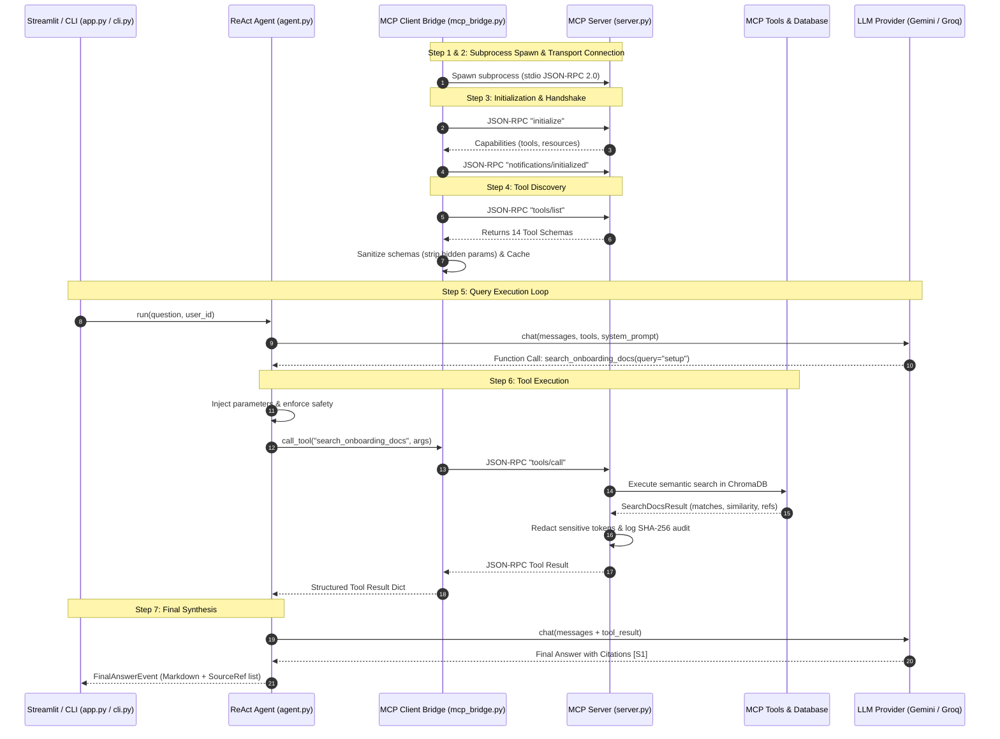

# Onboarding Assistant

A goal-based, tool-augmented (ReAct) AI developer assistant designed to eliminate onboarding friction for software engineers joining enterprise and open-source software repositories. Grounded on an official Model Context Protocol (MCP) stdio server, dual-provider LLM failover, semantic RAG over repository documentation, an editorial Streamlit web application, and a developer-first CLI with human-in-the-loop write approval.

---

## 1. Project Overview

### Project Purpose and Problem Statement
Software engineer onboarding is one of the costliest and most fragmented productivity bottlenecks in modern engineering organizations:
- **Lost Engineering Velocity**: New hires routinely spend their first 2 to 4 weeks configuring complex development toolchains, setting up compiler targets, and deciphering undocumented tribal conventions.
- **Maintainer Interruption Fatigue**: Experienced maintainers and senior developers are frequently pulled out of focused flow to answer repetitive questions (*"How do I run tests?", "Where does the parser live?", "Who owns the linter crate?"*).
- **Out-of-Date or Fragmented Documentation**: Setup instructions, architecture notes, and contribution guidelines are often scattered across repository READMEs, issue templates, wikis, and PR threads.
- **Task Paralysis & Duplicate Effort**: Junior contributors struggle to determine which beginner-friendly issues are genuinely unworked versus those that already have active work-in-progress pull requests.

### What the Project Does
The **Onboarding Assistant** acts as a 24/7 AI-powered technical mentor directly connected to the target repository (benchmarked on [Astral's Ruff](https://github.com/astral-sh/ruff) — a high-performance Python linter and formatter written in Rust).

The system blends two distinct operational layers:
1. **Verified Knowledge RAG**: Semantic vector search over indexed repository documentation, setup guides, and FAQs via ChromaDB with strict citation attribution.
2. **Live Ground Truth**: Live GitHub REST API tools that inspect repository state (open issues, active pull requests, crate structures, commit recency) in real time without ingesting raw source code.
3. **Human-in-the-Loop Safety**: All write actions (e.g. marking onboarding checklist tasks done or logging documentation gaps) generate structured proposal cards requiring explicit human approval before any database state is modified.
4. **Resilient Dual-Provider LLM Core**: An automated 60-second circuit breaker transitions seamlessly from Google Gemini 3.5 Flash Lite (primary) to Groq LLaMA 3.3 70B (fallback) upon 429 rate limits, 5xx outages, or timeouts.

### Key Features and Real-World Use Cases
- **Toolchain & Setup Guidance**: Answers developer questions about build commands, cargo workspaces, pre-commit hooks, and test fixtures grounded directly in `CONTRIBUTING.md`.
- **Local Environment Doctor**: Audits the developer machine (Python version, virtual environment status, Git CLI, and Rust toolchain targets) and provides actionable remediation steps.
- **Automated PR Pre-Flight Audit**: Scans pull request titles, templates, and changed files to ensure test coverage is present and blocks PRs touching restricted paths (e.g., `.env`, `.github/workflows`).
- **Code Ownership Discovery**: Resolves module maintainers using `.github/CODEOWNERS` rules, falling back to 90-day git commit recency analysis when no static rule exists.
- **Deduplicated Issue Discovery**: Discovers `good-first-issue` items while actively cross-referencing open pull request titles and descriptions to filter out issues already claimed.
- **Onboarding Milestone Tracking**: Guides developers through a 12-milestone onboarding roadmap with personalized progress tracking across junior, backend, and systems personas.
- **Engineering Lead Oversight**: Aggregates cohort velocity, highlights stalled team members, identifies top onboarding bottlenecks, and synthesizes structured Senior Escalation Packets for Slack or Teams.

---

## 2. Architecture

### Overall System Architecture
The application is structured into decoupled, modular tiers:
1. **User Interface Tier**: Editorial Streamlit web application (`app.py`, `ui/`) and terminal CLI (`cli.py`).
2. **Agent Core Tier**: ReAct reasoning loop (`agent/agent.py`) with typed event generation, conversation history management, and security guardrails.
3. **LLM Provider Tier**: Dual-provider abstraction (`agent/llm_provider.py`) with Google Gemini primary, Groq fallback, and a 60-second circuit breaker.
4. **Concurrency Bridge Tier**: Thread-safe synchronous bridge (`agent/mcp_bridge.py`) running an `asyncio` event loop on a dedicated background thread (configured with `WindowsProactorEventLoopPolicy` on Windows).
5. **Model Context Protocol (MCP) Server Tier**: Stdio server (`mcp_server/server.py`) exposing 14 tools and URI-addressable handbook resources (`handbook://{path}`).
6. **Data Governance & Persistence Tier**: Privacy firewall (`mcp_server/privacy.py`), ChromaDB vector store (`data/chroma_store`), and SQLite database (`data/onboarding.db`).

### Component Roles
- **AI Agent (`agent/agent.py`)**: Orchestrates the multi-step ReAct reasoning loop. It evaluates user prompts, queries available tools, constructs conversation history, parses LLM tool calls, enforces parameter injection (`user_id`, `dry_run=True`), and halts execution upon generating a final answer or reaching the step cap.
- **LLM (`agent/llm_provider.py`)**: Serves as the cognitive engine. It parses user intent, selects appropriate tools with structured arguments, and synthesizes grounded final responses from tool results.
- **MCP Client (`agent/mcp_bridge.py`)**: Spawns and manages the MCP server subprocess over standard I/O (stdio). It performs protocol handshake, queries tool definitions, sanitizes schemas by hiding internal parameters, and executes tools synchronously on behalf of the agent.
- **MCP Server (`mcp_server/server.py`)**: Implements the official Model Context Protocol (JSON-RPC 2.0). It hosts tool implementations, validates schemas using Pydantic, enforces the privacy filter, and routes requests to live GitHub APIs or local databases.
- **MCP Tools (`mcp_server/tools/*`)**: Discrete, single-purpose executable units that interact with GitHub REST endpoints, query ChromaDB embeddings, audit local environments, or mutate SQLite state.

### Architecture Diagram


---

## 3. MCP Workflow

The Model Context Protocol (MCP) establishes a standardized, open protocol for bidirectional communication between AI applications (clients) and data sources/tools (servers) over standard I/O streams using JSON-RPC 2.0.

### Complete MCP Lifecycle Step-by-Step

1. **Client Initialization**:
   - When the application starts, `get_mcp_bridge()` spawns a dedicated background worker thread (`MCPBridgeThread`).
   - On Windows, the thread configures `asyncio.WindowsProactorEventLoopPolicy()` to ensure non-blocking pipe I/O.
   - The thread creates an `asyncio` event loop and instantiates `StdioServerParameters` specifying `python -m mcp_server.server` with unbuffered I/O (`PYTHONUNBUFFERED=1`).

2. **Server Connection**:
   - The client invokes `stdio_client(server_params)` which launches the server as a child subprocess.
   - Standard input and standard output pipes are bound to asynchronous read and write streams.
   - Diagnostic log messages on the server are routed strictly to standard error (`stderr`) to prevent JSON-RPC frame corruption.

3. **Initialization & Capability Negotiation**:
   - The client issues an `initialize` JSON-RPC method request containing client metadata (`mcp-client`) and protocol version (`2024-11-05`).
   - The server responds with server information (`onboarding-assistant`, version `1.0.0`) and declares its capabilities: `{"tools": {}, "resources": {}}`.
   - The client completes the handshake by sending an `initialized` notification.

4. **Tool Discovery (`tools/list`)**:
   - The bridge calls `session.list_tools()`, sending a `tools/list` JSON-RPC request.
   - The server inspects all registered `@server.tool` functions and returns their names, descriptions, and Pydantic JSON schemas.
   - The bridge intercepts the response, strips internal parameters (`user_id`, `dry_run`, `repo`) from the schema, and caches the definitions in memory (`self._cached_tools`).

5. **Tool Invocation (`tools/call`)**:
   - When the LLM decides to call a tool, the agent extracts the tool name and arguments.
   - The agent injects required session parameters (`user_id`) and safety flags (`dry_run=True` for write tools).
   - The bridge dispatches `session.call_tool(name, arguments)` over the stdio JSON-RPC stream via `asyncio.run_coroutine_threadsafe`.

6. **Tool Execution & Response Handling**:
   - The server receives `tools/call`, runs argument validation against Pydantic models, and executes the target tool function.
   - The output is sanitized by the privacy layer (redacting tokens and secrets) and formatted as structured JSON.
   - The server logs an immutable audit entry in SQLite (recording timestamps, status, byte count, redaction counts, and SHA-256 argument hashes).
   - The JSON-RPC response is emitted over stdout back to the client.

7. **Synthesizing the Final LLM Response**:
   - The bridge parses the returned JSON payload and hands it back to the agent.
   - The agent appends a `role: tool` message to conversation history containing the structured result.
   - The conversation history is resent to the LLM. The LLM interprets the result, extracts facts, formulates citations (`[S1]`), and outputs the final markdown answer.

### MCP Communication Sequence Diagram



---

## 4. AI Agent Workflow

### Goal-Based Execution
The Onboarding Assistant is a **goal-driven agent**. Rather than following a rigid script, it is given an objective (e.g. *"Find open beginner issues that have no active pull requests"* or *"Diagnose my local build failure"*). It autonomously evaluates what information it has, determines what missing data is needed, selects and executes tools, and evaluates intermediate results until the objective is achieved.

### Agent Reasoning and Tool Selection
The agent utilizes the **ReAct (Reasoning + Acting)** framework:
1. **Thought / Reason**: The LLM analyzes the conversation history, active persona guidance, and available tool declarations. It reasons about what step to take next.
2. **Act**: The LLM outputs a structured tool invocation request containing the chosen tool name and specific arguments.
3. **Observe**: The agent executes the tool via the MCP bridge and supplies the structured observation back to the model as a `role: tool` message.
4. **Synthesize**: The model reads the observation. If more information is needed, it loops back to step 1. If sufficient data exists, it synthesizes the final response.

### Execution Loop & Step Cap
To prevent infinite loops or runaway API consumption, the agent enforces hard constraints:
- **Max Tool Steps Cap (`MAX_TOOL_STEPS = 6`)**: If the agent executes 6 consecutive tool calls without producing a final text answer, the loop terminates immediately. It compiles all data collected up to that step and returns a graceful partial answer.
- **Session Result Cache**: If the agent attempts to call a tool with the exact same arguments within the same turn, the result is served instantly from memory (`self._session_cache`) without redundant network requests.
- **Conversation History Truncation**: Chat history is capped at the 6 most recent turns, and raw tool outputs exceeding 4,000 characters are safely truncated to keep prompt payloads within token limits.

### How the Agent Decides When to Stop
The ReAct loop stops under one of three deterministic conditions:
1. **Completion**: The LLM returns a text response with `tool_calls = []`. This indicates the model has sufficient facts to answer the user's inquiry completely.
2. **Step Exhaustion**: The iteration counter reaches `max_tool_steps = 6`.
3. **Proposal Generation**: When a write tool (`mark_task_done` or `log_question`) is executed, it runs with `dry_run=True`. The agent emits a `ProposalRequestedEvent`, yields the proposed change card for the human reviewer, and halts further autonomous execution pending user action.

### Agentic AI vs AI Agent
To clarify a common distinction in modern AI systems:
- **AI Agent**: A specific software component or autonomous program that perceives its environment through tools or sensors, processes information with an LLM, and takes actions through tool calls to achieve a defined goal (e.g., `agent/agent.py`).
- **Agentic AI**: The overarching architectural paradigm or design philosophy where AI systems are built with agency, autonomy, proactive planning, multi-step problem solving, error recovery, and tool-augmented reasoning, as opposed to passive single-turn conversational chatbots that only predict the next token based on static context.

---

## 5. Important Technical Concepts

### MCP vs Function Calling
- **Traditional Function Calling**: A proprietary mechanism specific to an LLM provider (e.g., OpenAI Function Calling or Google Gemini Tool Use). It requires defining provider-specific JSON schemas, manually maintaining client endpoints, and writing bespoke adapters for every external service. If you switch LLM providers, tool wiring must often be rewritten.
- **Model Context Protocol (MCP)**: An open, standardized protocol developed by Anthropic that separates tools from the LLM provider. MCP standardizes tool definitions, tool invocations, and resource streaming over standard transports (stdio, SSE) using JSON-RPC 2.0. Any MCP client can connect to any MCP server regardless of whether the model is Gemini, Claude, LLaMA, or GPT.

### Why MCP was Chosen
1. **Separation of Concerns**: Tool implementations and database logic reside in `mcp_server/`, completely isolated from LLM provider logic in `agent/llm_provider.py`.
2. **Universal IDE & Ecosystem Integration**: The exact same MCP server (`python -m mcp_server.server`) can be plugged directly into modern developer IDEs like Cursor, Claude Code, and VS Code without modifying code.
3. **Enterprise Security Boundary**: Sensitive operations, token redaction, and audit logging happen at the MCP server boundary, ensuring LLMs only see sanitized data.

### Top-P, Top-K, and Temperature

```
Low Temperature (0.2) ──► Deterministic, Grounded, Factual (Used in this Project)
High Temperature (1.0) ─► Creative, Varied, Higher Risk of Hallucination
```

- **Temperature (`0.2` in this project)**: Controls the randomness of the model's next-token selection. In this application, temperature is intentionally set to `0.2` across both Gemini and Groq adapters. For technical onboarding, deterministic, factually grounded answers with zero hallucinations are required.
- **Top-P (Nucleus Sampling)**: Dynamically selects tokens from the smallest set whose cumulative probability exceeds probability $p$ (e.g., `0.95`). It cuts off low-probability tails while allowing natural variance.
- **Top-K (Vocabulary Truncation)**: Restricts token selection to the $k$ highest-probability tokens at each step.

### Tokens and LLM Cost
- **Tokens**: The basic units of text processed by LLMs (~4 characters or 0.75 words per token).
- **Cost Structure**: LLMs charge per million input and output tokens. Uncontrolled tool calling or sending full source code files can rapidly exhaust token budgets.
- **Project Cost Optimizations**:
  1. *Zero Source Code Ingestion*: The system never ingests `.rs` or `.py` source files. It reads only documentation chunks and directory listings, keeping input token volume minimal.
  2. *History Truncation*: Conversation turns are capped at the most recent 6 messages.
  3. *Payload Truncation*: Tool payloads longer than 4,000 characters are truncated.
  4. *Benchmark Efficiency*: The complete 12-question benchmark suite executed at **$0.00** total cost using free-tier quotas.

### Prompt Engineering and Tool Calling in this Project
- **Strict Grounding Directive**: The system prompt (`agent/system_prompt.py`) explicitly forbids the model from assuming or inventing repository details: *"Every statement, command, file path, code owner, and issue number MUST come directly from tool outputs."*
- **Dual-Knowledge Routing**: Instructs the model when to call local handbook tools (`search_onboarding_docs`) versus live GitHub tools (`get_directory_listing`, `find_code_owners`).
- **Untrusted Content Demarcation**: Tool outputs (issues, PRs, commit messages) are declared as untrusted external data, protecting the agent against prompt injection attacks embedded in issue titles.
- **Persona Adaptation**: Automatically injects role-specific guidance (`Junior Contributor`, `Backend / Systems`, `Team Lead`) to calibrate technical depth and tone.

---

## 6. Technology Stack

| Technology / Library | Version | Purpose in this Project |
|---|---|---|
| **Python** | `3.11.3+` | Core programming language for runtime, agent, server, and CLI |
| **Model Context Protocol (`mcp`)** | `2.3.0` | Official MCP Python SDK providing `MCPServer`, stdio client, and JSON-RPC transport |
| **Google GenAI SDK (`google-genai`)** | `2.11.0` | Official client for primary LLM (`gemini-3.5-flash-lite`) with native function calling |
| **Groq SDK (`groq`)** | `1.7.0` | High-speed inference client for fallback LLM (`llama-3.3-70b-versatile`) |
| **ChromaDB (`chromadb`)** | `1.5.9` | Persistent local vector database storing embeddings of repository documentation |
| **Sentence-Transformers** | `6.2.0` | Generates 384-dimensional dense vector embeddings (`all-MiniLM-L6-v2`) |
| **PyTorch (`torch`)** | `2.15.0` | Tensor computation engine powering the local embedding model |
| **Streamlit (`streamlit`)** | `1.59.2` | Web interface delivering editorial design, real-time ReAct traces, and proposal cards |
| **SQLite3** | `3.x` (Standard) | Persistent store for 12 onboarding tasks, sample user personas, question logs, and security audit records |
| **HTTPX (`httpx`)** | `0.28.1` | Asynchronous and synchronous HTTP client for GitHub REST API with caching |
| **Pydantic & Settings** | `2.14.2` | Strict data validation, schema generation, and environment loading |
| **Pathspec (`pathspec`)** | `1.1.1` | Git-style pattern matching engine used to parse `.github/CODEOWNERS` rules |
| **Pytest & Plugins** | `9.2.0` | Automated testing framework with `pytest-asyncio` and `respx` (HTTP mocking) |

---

## 7. Project Structure

```
.
├── app.py                     # Streamlit application entrypoint (Editorial UI)
├── cli.py                     # Developer & Senior CLI entrypoint (8 subcommands)
├── config.py                  # Validated application configuration and env loading
├── logging_config.py          # Centralized rotating file and audit trail logging
├── pyproject.toml             # Pytest configuration and project metadata
├── requirements.txt           # Pinned production dependency versions
├── PROGRESS.md                # Comprehensive implementation checklist and test records
├── README.md                  # Complete technical documentation and reviewer guide
│
├── agent/                     # ReAct agent, LLM failover, and MCP concurrency bridge
│   ├── __init__.py
│   ├── agent.py               # ReAct reasoning loop, event streaming, and proposal logic
│   ├── events.py              # Typed dataclass events (ToolCall, ToolResult, Proposal, etc.)
│   ├── llm_provider.py        # Dual-provider LLM client (Gemini primary, Groq fallback)
│   ├── mcp_bridge.py          # Concurrency bridge running async MCP client in background thread
│   └── system_prompt.py       # Grounding prompt, persona guidance, and anti-injection guards
│
├── mcp_server/                # Model Context Protocol stdio server implementation
│   ├── __init__.py
│   ├── server.py              # FastMCP server exposing 14 tools and handbook resources
│   ├── db.py                  # SQLite helper and audit logging connection
│   ├── github_client.py       # Async HTTP client for GitHub REST API with caching
│   ├── privacy.py             # Privacy rules: path denylist, redaction, and audit logging
│   ├── schemas.py             # Pydantic schemas for all tool inputs, outputs, and refs
│   └── tools/                 # Tool implementations
│       ├── live_issue_tools.py     # Good first issues and recent PRs
│       ├── live_owner_tools.py     # CODEOWNERS parser and git commit fallback
│       ├── live_repo_tools.py      # Repository overview and directory listing
│       ├── live_review_tools.py    # Automated PR pre-flight checks
│       ├── local_diagnostic_tools.py # Compiler and build error diagnostics
│       ├── local_doctor_tools.py   # Local developer environment diagnostics
│       ├── local_escalation_tools.py # Senior escalation packets and cohort progress
│       ├── local_handbook_tools.py # ChromaDB RAG search over handbook
│       └── local_progress_tools.py # User progress and question logging
│
├── ui/                        # Editorial Streamlit interface components
│   ├── __init__.py
│   ├── components.py          # Custom headers, proposal cards, and progress bars
│   ├── theme.py               # Custom editorial CSS, typography, and color palette
│   └── views.py               # Ask view, Path view, Lead oversight view, Question log view
│
├── scripts/                   # Verification and data initialization utilities
│   ├── check_env.py           # Validates environment keys and GitHub API connectivity
│   ├── check_llm.py           # Validates Gemini and Groq live API connectivity
│   ├── fetch_handbook.py      # Downloads real documentation from target GitHub repo
│   ├── ingest_handbook.py     # Chunks markdown and generates vector embeddings
│   ├── seed_db.py             # Seeds SQLite database with tasks and sample personas
│   └── verify_ui_render.py    # Automated headless UI screenshot validation script
│
├── tests/                     # Unit and integration test suite (51 tests)
│   ├── test_agent.py          # ReAct reasoning loop, caching, and proposal emission
│   ├── test_enhanced_features.py # Doctor, PR pre-flight, diagnostics, cohort, and CLI tests
│   ├── test_handbook_ingest.py# Markdown chunking, embedding, and ChromaDB search
│   ├── test_llm_provider.py   # Gemini client, Groq fallback, and circuit breaker
│   ├── test_logging.py        # Centralized logging and SQLite audit trail tests
│   ├── test_privacy.py        # Path denylist, credential redaction, and SHA-256 audit
│   ├── test_tools.py          # Live GitHub REST tools mocked with respx
│   └── test_ui_smoke.py       # Streamlit AppTest framework verifying UI boot and navigation
│
├── eval/                      # Evaluation questions and automated benchmark script
│   ├── questions.json         # 12 representative test questions with ground truth
│   └── run_eval.py            # Evaluation benchmark runner generating metrics
│
├── docs/                      # Comprehensive documentation and screenshots
│   ├── architecture.md        # Detailed system design, component breakdown, and diagram
│   ├── demo_script.md         # Walkthrough script for live demonstration and defense
│   ├── evaluation.md          # Evaluation benchmark report and similarity analysis
│   ├── privacy_and_data_governance.md # Deep dive into 6-pillar privacy architecture
│   ├── problem_statement.md   # Problem definition and explicit solution scope
│   └── screenshots/           # Captured desktop and mobile interface renderings
│
├── logs/                      # Runtime application logs
│   └── onboarding.log         # Centralized activity log file
│
└── data/                      # Local runtime data stores
    ├── handbook/              # Fetched and authored markdown documentation
    ├── chroma_store/          # ChromaDB persistent vector database
    └── onboarding.db          # SQLite database (checklists, users, audit logs)
```

---

## 8. Installation and Setup (Step-by-Step for L2 Reviewers)

Follow these exact steps to run and test the project on your machine. All commands are formatted for **Windows PowerShell** first, with **macOS / Linux Bash** alternatives provided.

### Step 1: Verify Prerequisites
Make sure you have installed:
- **Python 3.11.x**: Verify by running `python --version` (e.g. Python 3.11.3).
- **Git**: Verify by running `git --version`.

### Step 2: Clone the Repository
```powershell
git clone https://github.com/PS-Divya-Rajput/onboarding-assistant_L2_project.git
cd onboarding-assistant_L2_project
```
*(On macOS / Linux: identical commands)*

### Step 3: Create and Activate Virtual Environment
**Windows PowerShell**:
```powershell
python -m venv venv
.\venv\Scripts\Activate.ps1
```
> **PowerShell Execution Policy Tip**: If you see `running scripts is disabled on this system`, run this once in your current PowerShell window:
> ```powershell
> Set-ExecutionPolicy -Scope Process -ExecutionPolicy Bypass
> ```

**macOS / Linux Bash**:
```bash
python3 -m venv venv
source venv/bin/activate
```

### Step 4: Install Dependencies
```powershell
pip install -r requirements.txt
```

### Step 5: Configure Environment Variables and API Keys
Create your local `.env` file from `.env.example`:

**Windows PowerShell**:
```powershell
Copy-Item .env.example .env
```
*(On macOS / Linux: `cp .env.example .env`)*

Open `.env` in any text editor and populate the three required keys:
```ini
GOOGLE_API_KEY=your_gemini_api_key_here
GROQ_API_KEY=your_groq_api_key_here
GITHUB_TOKEN=your_github_token_here
TARGET_REPO=astral-sh/ruff
GEMINI_MODEL=gemini-3.5-flash-lite
GROQ_MODEL=llama-3.3-70b-versatile
LLM_TIMEOUT_SECONDS=20
MAX_TOOL_STEPS=6
SIMILARITY_THRESHOLD=0.30
GOOD_FIRST_LABELS=good first issue,good-first-issue,help wanted
PATH_DENYLIST=.env,secrets,.github/workflows,config/prod,id_rsa
```

**Where to get free API keys**:
1. `GOOGLE_API_KEY`: Instant free key at [Google AI Studio](https://aistudio.google.com/app/apikey) (no credit card needed).
2. `GROQ_API_KEY`: Instant free key at [Groq Cloud Console](https://console.groq.com/keys) (no credit card needed).
3. `GITHUB_TOKEN`: Create a personal access token at [GitHub Developer Settings](https://github.com/settings/tokens) with `public_repo` read permissions.

### Step 6: Verify Environment and Seed the Database

**A. Verify Environment Keys and GitHub API Connectivity**:
```powershell
python scripts/check_env.py
```
*Expected Output: Confirms environment variables, GitHub core rate limits, and access to `astral-sh/ruff`.*

**B. Verify Live LLM Connectivity (Gemini & Groq)**:
```powershell
python scripts/check_llm.py
```
*Expected Output: `PASS` on both text completion and forced tool-calling.*

**C. Initialize and Seed SQLite Database**:
```powershell
python scripts/seed_db.py
```
*Expected Output: Creates tables in `data/onboarding.db` and seeds 12 handbook milestones, 3 personas, and initial question history.*

> **Vector Database Note**: Pre-computed ChromaDB vector embeddings (`data/chroma_store/`) and handbook markdown files (`data/handbook/`) are already bundled with the repo. You do **not** need to re-download or re-embed docs to run the project.

### Step 7: Launch the Client / Application

#### Option A: Launch the Streamlit Web Application
```powershell
streamlit run app.py
```
Open your browser to `http://localhost:8501`.

#### Option B: Run via Developer CLI (Terminal Interface)
```powershell
python cli.py ask "How do I build Ruff locally?" --user user_ravi
```

### Step 8: Standalone MCP Server Startup Command (For IDE Integration)
If you want to run or inspect the Model Context Protocol server independently over stdio:
```powershell
python -m mcp_server.server
```
*(The server listens on standard input and emits JSON-RPC 2.0 messages on standard output)*

To inspect the server using the official MCP Inspector:
```powershell
npx @modelcontextprotocol/inspector python -m mcp_server.server
```

### Step 9: Common Errors & Troubleshooting

| Symptom / Error | Root Cause | Solution |
|---|---|---|
| `.\venv\Scripts\Activate.ps1 cannot be loaded because running scripts is disabled` | Windows PowerShell execution policy restriction | Run `Set-ExecutionPolicy -Scope Process -ExecutionPolicy Bypass` in the current terminal window. |
| `HTTP 403: rate limit exceeded` in `check_env.py` | Missing or invalid `GITHUB_TOKEN` | Provide a valid GitHub Personal Access Token in `.env`. Authenticated tokens receive 5,000 requests/hr vs 60/hr unauthenticated. |
| `Streamlit: Port 8501 is already in use` | Another local process is using port 8501 | Run on a different port: `streamlit run app.py --server.port 8502`. |
| Header badge shows `Groq, fallback active` | Gemini 429 quota exhaustion or network timeout | Normal circuit breaker operation. The system automatically routed the request to Groq LLaMA 3.3 70B to avoid downtime. Resets automatically after 60s. |
| `ModuleNotFoundError: No module named 'mcp'` | Virtual environment not activated | Activate virtual environment (`.\venv\Scripts\Activate.ps1` or `source venv/bin/activate`) before running. |

---

## 9. Available MCP Tools Reference

The MCP server exposes **14 specialized tools** categorized into three functional groups:

| Tool Name | Category | Input Parameters | Description & Functionality |
|---|---|---|---|
| **`get_repo_overview`** | Live GitHub | *None* | Fetches high-level repository metadata for `TARGET_REPO` including description, stars, forks, default branch, primary languages, and license. |
| **`get_directory_listing`** | Live GitHub | `path: str = ""` | Lists files and subdirectories for a given repository path without reading file contents, respecting the path denylist. |
| **`list_good_first_issues`** | Live GitHub | `limit: int = 5`,<br>`exclude_with_open_pr: bool = True` | Retrieves beginner-friendly issues (`good first issue`, `help wanted`) and cross-references open pull requests to exclude issues already being worked on. |
| **`find_code_owners`** | Live GitHub | `path: str` | Evaluates `.github/CODEOWNERS` rules using path specification patterns, falling back to 90-day git commit recency analysis when no static rule exists. |
| **`get_recent_prs`** | Live GitHub | `state: str = "open"`,<br>`limit: int = 8` | Retrieves metadata for recent pull requests (titles, authors, review statuses, URLs) without fetching raw diffs. |
| **`search_onboarding_docs`** | Local Knowledge | `query: str`,<br>`top_k: int = 4` | Performs dense semantic vector search over the repository handbook in ChromaDB using `all-MiniLM-L6-v2` embeddings and cosine similarity. |
| **`get_onboarding_progress`** | Local Knowledge | `user_id: str` | Returns the 12-milestone onboarding checklist, completed steps count, and next suggested milestone for the specified developer. |
| **`mark_task_done`** | Local Knowledge | `user_id: str`,<br>`task_id: int`,<br>`dry_run: bool = True` | Marks an onboarding checklist milestone as completed. Defaults to `dry_run=True` to generate a preview proposal for human approval. |
| **`log_question`** | Local Knowledge | `user_id: str`,<br>`question: str`,<br>`answered_from: str = "none"`,<br>`resolved: bool = False`,<br>`dry_run: bool = True` | Logs developer questions and their resolution source. Defaults to `dry_run=True` to generate a preview proposal before persisting. |
| **`diagnose_local_environment`** | Diagnostics | *None* | Audits the local machine environment (Python version, virtual environment status, Git CLI, Rust toolchain) against project prerequisites. |
| **`check_pr_preflight`** | Diagnostics | `pr_number: Optional[int]`,<br>`title: str = ""`,<br>`body: str = ""`,<br>`files_changed: Optional[list[str]]` | Audits a pull request against repository templates, verifies test plan presence, and detects modifications to sensitive paths (`.env`, `.github/workflows`). |
| **`diagnose_build_error`** | Diagnostics | `error_log: str` | Analyzes compiler or test error logs (e.g. Rust borrow-checker errors, Python import failures) and suggests specific code fixes and code owners. |
| **`generate_smart_escalation`** | Lead Oversight | `user_id: str`,<br>`question: str`,<br>`steps_attempted: Optional[list[str]]`,<br>`path_context: Optional[str]` | Synthesizes a structured Senior Escalation Packet formatted with developer context, attempted steps, and relevant code owners for Slack/Teams. |
| **`get_cohort_progress`** | Lead Oversight | *None* | Aggregates onboarding velocity, completion percentages, and milestone bottlenecks across all team members for engineering leads. |

### MCP Resources
- **`handbook://{path}`**: Read-only URI access to sanitized markdown handbook documents, blocked if matching any path denylist pattern.

---

## 10. Testing and L2 Review Preparation

### Automated Test Suite Execution
The repository contains **51 automated unit and integration tests** verifying all modules:

```powershell
python -m pytest -v
```

All 51 tests pass cleanly without failures or unhandled exceptions:
- `tests/test_agent.py` (8 tests): ReAct loop steps, tool dispatch, caching, injection defense, and proposal emission.
- `tests/test_enhanced_features.py` (9 tests): Environment doctor, PR pre-flight, build error diagnostics, smart escalation, cohort velocity, and CLI subcommands.
- `tests/test_handbook_ingest.py` (8 tests): Front-matter validation, markdown chunking, semantic ChromaDB search, dry-run safety, and MCP resources.
- `tests/test_llm_provider.py` (7 tests): Gemini execution, Groq failover on 429/500/timeouts, and 60s circuit breaker transitions.
- `tests/test_logging.py` (4 tests): Centralized logging, level filtering, SQLite audit trail retrieval, and CLI commands.
- `tests/test_privacy.py` (7 tests): Path denylist, credential redaction, private key scrubbing, and SHA-256 audit logging.
- `tests/test_tools.py` (6 tests): Live GitHub REST tools mocked with `respx`.
- `tests/test_ui_smoke.py` (2 tests): Streamlit `AppTest` framework verifying clean application boot and 4-tab navigation switching.

---

### Complete End-to-End Execution Trace Example

Here is a real execution trace demonstrating how a user query moves through the agent, MCP client, MCP server, and LLM:

1. **User Query**:
   > *"How do I set the project up locally and build Ruff?"*

2. **Agent Reasoning**:
   The agent initializes conversation history, injects active persona guidance (`Junior Contributor`), and calls Gemini with tool declarations:
   ```json
   {
     "thought": "The user is asking about local setup and build instructions for Ruff. I should check the local onboarding handbook for setup prerequisites.",
     "tool_call": {
       "name": "search_onboarding_docs",
       "args": {"query": "setup prerequisites build Ruff locally"}
     }
   }
   ```

3. **MCP Tool Execution**:
   - The MCP bridge sends a `tools/call` JSON-RPC request to `mcp_server.server`.
   - The tool runs dense vector search in ChromaDB and returns:
   ```json
   {
     "coverage": "high",
     "matches": [
       {
         "file": "CONTRIBUTING.md",
         "heading_path": "The Basics > Prerequisites",
         "similarity": 0.78,
         "text": "To build Ruff locally, install the Rust toolchain (1.80+) via rustup and the Astral uv package manager. Run cargo run -p ruff -- check <file> --no-cache to build and execute the linter."
       }
     ],
     "source_refs": [
       {"id": "S1", "kind": "local", "label": "CONTRIBUTING.md", "url": "https://github.com/astral-sh/ruff/blob/main/CONTRIBUTING.md"}
     ]
   }
   ```

4. **MCP Server Privacy & Audit**:
   - Redaction engine scans payload (0 tokens redacted).
   - Server writes cryptographic audit record to SQLite: `tool=search_onboarding_docs, status=success, bytes=482, args_sha256=9f83...`.

5. **Final LLM Response Synthesis**:
   The agent feeds the tool observation back to the model. The model produces the final answer:
   > To set up the repository locally and build Ruff, install the **Rust toolchain** (1.80+) using `rustup` and Astral's **`uv`** package manager. You can build and run the linter directly with:
   > ```bash
   > cargo run -p ruff -- check <file> --no-cache
   > ```
   > Run test suites using `cargo test -p ruff_python_parser` or `cargo nextest run`.
   >
   > *Sources: [S1] CONTRIBUTING.md*

---

### Key Technical Discussion Points & Possible L2 Reviewer Questions

#### Q1: Why did you build an MCP server instead of using direct Python function calling in the agent?
**Answer**: Direct function calling tightly couples the tools to a specific LLM SDK (e.g. OpenAI or Gemini). By implementing an official Model Context Protocol (MCP) server over standard I/O (stdio), the tools become decoupled, reusable microservices. The exact same MCP server can be accessed simultaneously by our Streamlit application, our terminal CLI, or external developer tools like Cursor, Claude Code, and VS Code without altering tool logic. Additionally, it establishes a clean security perimeter for input sanitization and zero-payload audit logging.

#### Q2: How does the agent prevent hallucinations when asked about unanswerable questions?
**Answer**: Grounding is enforced at both the prompt level and the algorithmic level. Algorithmically, `search_onboarding_docs` computes cosine similarity between the query embedding and handbook chunks. If top similarity falls below `0.30`, the tool returns `coverage: 'none'` and `matches: []`. In `agent/system_prompt.py`, rule #3 explicitly instructs the agent that if coverage is 'none', it must admit that it does not know and propose logging the question rather than inventing repository facts. In our benchmark, the system achieved a **100% honest unknown rate** (3 out of 3 unanswerable questions correctly admitted).

#### Q3: How do you prevent unauthorized writes or accidental state mutations?
**Answer**: Through our **Human-in-the-Loop Protocol**. Write tools (`mark_task_done` and `log_question`) enforce `dry_run = True` at the server boundary. Even if the LLM attempts to pass `dry_run = False`, the agent strips it and forces `True`. The tool generates a `WritePreview` and emits a `ProposalRequestedEvent`. The UI renders an amber proposal card with **Apply** and **Discard** buttons. Only when the human clicks Apply does the action execute with `dry_run = False`.

#### Q4: How is LLM provider resilience handled in production?
**Answer**: We implement a dual-provider abstraction with a **60-second circuit breaker** in `agent/llm_provider.py`. The primary provider is Google Gemini 3.5 Flash Lite. If Gemini returns HTTP 429 (quota exhausted), 5xx (server error), or times out, the error is logged, the circuit breaker trips, and the request immediately fails over to Groq (LLaMA 3.3 70B Versatile). For the next 60 seconds, all calls route directly to Groq to avoid compound latency, automatically testing Gemini recovery once the cooldown window elapses.

#### Q5: How do you protect proprietary intellectual property and prevent source code leaks to the LLM?
**Answer**: Through our **6-pillar zero-trust privacy architecture** (`mcp_server/privacy.py`). First, the system enforces *zero raw source code ingestion*—no tool reads or returns `.rs` or `.py` source files. Directory listings inspect filenames only. Second, sensitive paths (`.env`, `secrets`, `.github/workflows`) are blocked at the server boundary. Third, high-performance regex engines scrub GitHub tokens, AWS keys, bearer tokens, and private keys from all outputs. Finally, all tool calls are logged with SHA-256 argument hashes without persisting sensitive payload data.

---

## 11. Documentation Links

- [System Architecture](docs/architecture.md)
- [Problem Statement & Scope](docs/problem_statement.md)
- [Privacy & Data Governance](docs/privacy_and_data_governance.md)
- [Evaluation & Benchmark Report](docs/evaluation.md)
- [Live Demonstration Script](docs/demo_script.md)
- [Progress & Implementation History](PROGRESS.md)
