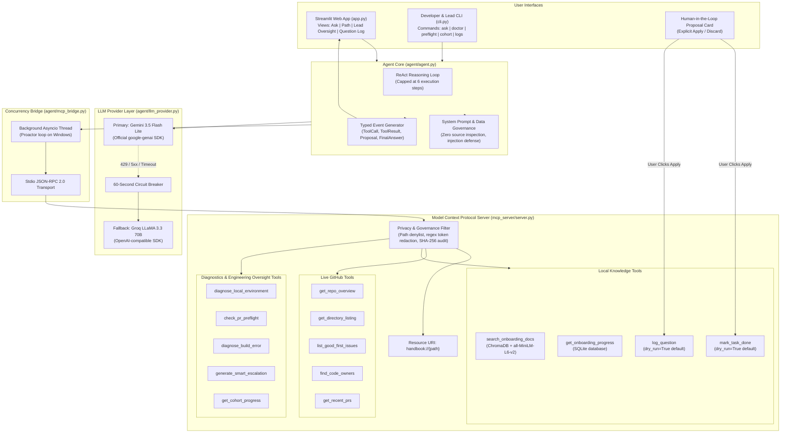

# Onboarding Assistant

A goal-based, tool-augmented (ReAct) AI assistant designed to eliminate developer onboarding friction in enterprise and open-source software repositories. Grounded on an official Model Context Protocol (MCP) stdio server, dual-provider LLM failover, semantic RAG over repository documentation, an editorial Streamlit web application, and a developer-first CLI with human-in-the-loop write approval.

---

## Executive Summary

Software developer onboarding is a major engineering productivity bottleneck. New engineers spend weeks deciphering build chains, hunting for module ownership, and asking repetitive questions, while senior engineers face persistent interruption fatigue.

The **Onboarding Assistant** solves this through a dual-knowledge architecture:
1. **Live Ground Truth**: Live GitHub REST tools inspect current repository state (issues, PRs, directory structures, code owners) without reading proprietary source code.
2. **Verified Knowledge RAG**: ChromaDB semantic vector search retrieves authoritative guidance from the repository handbook with strict citation attribution.
3. **Human-in-the-Loop Safety**: All state-modifying actions (such as logging documentation gaps or marking onboarding checklist milestones) are presented as proposed changes requiring explicit user confirmation before execution.
4. **Resilient Dual-Provider LLM Core**: Automatic 60-second circuit breaker transitions seamlessly from Google Gemini (primary) to Groq LLaMA 3.3 70B (fallback) upon 429 quota exhaustion, 5xx outages, or timeouts.
5. **Multi-Interface Access**: Accessible via a clean Streamlit web interface (`app.py`), a terminal CLI (`cli.py`), or as an independent Model Context Protocol stdio server for IDE integrations.

---

## Architecture and System Design



---

## Core Capabilities Mapped to Engineering Pain Points

| Engineering Pain Point | Onboarding Assistant Solution | Implementation & Tooling |
|---|---|---|
| **1. Toolchain & Setup Friction**: New hires spend days configuring toolchains, compiler targets, and local virtualenvs. | Automated environment diagnostics and semantic RAG search across verified repository setup guides. | `diagnose_local_environment` (audits Python, Rust, Git, and virtualenv) and `search_onboarding_docs` (RAG with source attribution). |
| **2. Senior Maintainer Interruption Fatigue**: Maintainers answer repetitive questions regarding code ownership, crate structures, and build errors. | Automated code ownership mapping, crate exploration, compiler diagnostic analysis, and formatted escalation packets. | `find_code_owners` (parses `CODEOWNERS` with commit fallback), `get_directory_listing`, `diagnose_build_error`, and `generate_smart_escalation`. |
| **3. Documentation Gaps & Tribal Knowledge**: Questions with missing documentation lead to developer stalling or tribal assumptions. | Explicit detection of documentation gaps with automated human-in-the-loop question logging. | Handbook similarity thresholding (`< 0.30` cosine similarity triggers honest admission) and `log_question` proposal generation. |
| **4. Task Paralysis & Duplicate Work**: Good-first-issues are often already being worked on in open pull requests. | Live unassigned beginner issue discovery filtered against all active pull requests. | `list_good_first_issues` (cross-references open PR titles and descriptions to filter out issues already claimed). |
| **5. PR Review Rework**: Juniors submit PRs missing required template checklists, snapshot test updates, or touching restricted paths. | Automated PR pre-flight audit enforcing repository standards prior to senior review. | `check_pr_preflight` (audits PR templates, test plans, and flags any modification to sensitive paths). |
| **6. Lack of Structured Milestones**: Onboarding lacks measurable milestones, leaving managers blind to onboarding stalls. | Interactive 12-milestone onboarding roadmap and cohort velocity analytics for leads. | `get_onboarding_progress`, proposal-guarded `mark_task_done`, and `get_cohort_progress` lead dashboard. |
| **7. Security & IP Leakage Fears**: Reluctance to expose proprietary source code or authentication keys to external LLMs. | Strict zero-trust privacy boundary, zero source code ingestion, and zero-payload audit logging. | Path denylist, regex token and private key scrubber, target repo locks, and cryptographic SHA-256 audit logging. |

---

## System Requirements & Prerequisites

- **Operating System**: Windows 10/11 (PowerShell), macOS, or Linux (bash).
- **Python**: Version 3.11 or higher (developed and verified on Python 3.11.3).
- **Git**: Installed and available in system PATH.
- **API Keys Required**:
  1. **Google Gemini API Key** (`GOOGLE_API_KEY`): Primary LLM provider. Available for free via [Google AI Studio](https://aistudio.google.com/).
  2. **Groq API Key** (`GROQ_API_KEY`): Fallback LLM provider for instant failover. Available for free via [Groq Cloud Console](https://console.groq.com/).
  3. **GitHub Personal Access Token** (`GITHUB_TOKEN`): Access token with public repository read permissions (`public_repo` scope). Available via [GitHub Developer Settings](https://github.com/settings/tokens).

---

## Quickstart Guide

Follow these steps to set up and run the project locally on your machine.

### Step 1: Clone or Navigate to the Repository

```powershell
cd c:\Users\DivyaRajput\Desktop\L2
```
*(On Linux/macOS: `cd /path/to/L2`)*

---

### Step 2: Create and Activate Virtual Environment

**Windows PowerShell**:
```powershell
python -m venv venv
.\venv\Scripts\Activate.ps1
```
> *Note for Windows*: If script execution is restricted, run `Set-ExecutionPolicy -Scope Process -ExecutionPolicy Bypass` in your PowerShell window prior to activating.

**Linux / macOS Bash**:
```bash
python3 -m venv venv
source venv/bin/activate
```

---

### Step 3: Install Dependencies

```powershell
pip install -r requirements.txt
```

---

### Step 4: Configure Environment Variables

Create your `.env` configuration from the provided `.env.example`:

**Windows PowerShell**:
```powershell
Copy-Item .env.example .env
```

**Linux / macOS Bash**:
```bash
cp .env.example .env
```

Open `.env` in any text editor and fill in your three API keys:

```ini
GOOGLE_API_KEY=your_gemini_api_key_here
GROQ_API_KEY=your_groq_api_key_here
GITHUB_TOKEN=your_github_token_here
TARGET_REPO=astral-sh/ruff
GEMINI_MODEL=gemini-3.5-flash-lite
GROQ_MODEL=llama-3.3-70b-versatile
LLM_TIMEOUT_SECONDS=20
MAX_TOOL_STEPS=6
SIMILARITY_THRESHOLD=0.30
GOOD_FIRST_LABELS=good first issue,good-first-issue,help wanted
PATH_DENYLIST=.env,secrets,.github/workflows,config/prod,id_rsa
```

---

### Step 5: Run Verification and Database Seeding Scripts

Execute the verification scripts in sequence to ensure your environment, network, and data stores are ready:

#### A. Validate Environment Keys and GitHub API Access
```powershell
python scripts/check_env.py
```
*Verifies `.env` keys, GitHub token authentication, core rate limits, and access to `TARGET_REPO`.*

#### B. Validate LLM Providers (Gemini & Groq)
```powershell
python scripts/check_llm.py
```
*Verifies live API connectivity, text generation, and forced tool-calling for both Gemini and Groq.*

#### C. Initialize and Seed the SQLite Database
```powershell
python scripts/seed_db.py
```
*Initializes tables and seeds 12 handbook milestones, 3 realistic developer personas (`user_ravi`, `user_elena`, `user_marcus`), and sample question history.*

> **Handbook Note**: Pre-computed vector embeddings (`data/chroma_store/`) and markdown documentation (`data/handbook/`) are already bundled with the repository. If you ever wish to re-fetch and re-embed documentation from GitHub, you can optionally run:
> ```powershell
> python scripts/fetch_handbook.py
> python scripts/ingest_handbook.py
> ```

---

### Step 6: Launch the Streamlit Web Application

Start the web application:

```powershell
streamlit run app.py
```

Open your browser to `http://localhost:8501`.

---

## Exploring the Web Interface

The Streamlit UI is built using an editorial aesthetic (warm paper background, Newsreader and IBM Plex typography, zero emojis) and features 4 dedicated views:

1. **Ask View**:
   - Natural language developer Q&A interface.
   - Provides suggested one-click prompts covering setup, diagnostics, PR pre-flight, and architecture.
   - Displays real-time ReAct execution traces (tool name, execution latency, local vs. live badge).
   - Shows verified source citation chips with permalinks.
   - Renders interactive amber **Proposed change** cards with **Apply** and **Discard** buttons when write operations are requested.

2. **Path View**:
   - Visual 12-milestone onboarding roadmap for the active developer persona.
   - Filter milestones by *All*, *To do*, or *Completed*.
   - One-click *Ask about this step* button to immediately query setup details for any milestone.

3. **Lead Oversight View**:
   - Engineering lead dashboard displaying team onboarding velocity.
   - Cohort overview metrics (average completion percentage, count of stalled developers).
   - Developer progress matrix showing milestone statuses across all team members.
   - Cohort bottleneck detection and senior escalation packet inspector.

4. **Question Log View**:
   - Audited chronological log of onboarding questions submitted by developers.
   - Filter by *All questions*, *Answered from handbook*, or *Gaps in handbook*.
   - Unresolved gaps highlight documentation deficiencies for team leads to address.

---

## Developer & Senior CLI (`cli.py`)

For developers and leads who prefer the terminal or want to integrate with IDEs (such as VS Code, Cursor, or terminal workflows), the project provides a comprehensive CLI entrypoint:

### 1. Ask an Onboarding Question
```powershell
python cli.py ask "How do I build Ruff locally?" --user user_ravi
```
*Runs the full ReAct agent loop, executes tools, and prints the grounded final answer with citations directly to stdout.*

### 2. Run Local Environment Diagnostics
```powershell
python cli.py doctor
```
*Audits installed Python version, virtual environment status, Git CLI availability, and Rust toolchain targets against project prerequisites.*

### 3. Run Automated PR Pre-Flight Audit
```powershell
python cli.py preflight --title "Add AST visitor for match expressions"
```
*Checks PR title conventions, template adherence, test verification plans, and warns if sensitive paths are touched.*

### 4. Inspect Individual Milestone Progress
```powershell
python cli.py progress --user user_ravi
```
*Outputs completed milestone count, remaining steps, and recommended next action for the selected developer.*

### 5. Inspect Team Cohort Velocity (Engineering Lead View)
```powershell
python cli.py cohort
```
*Displays cohort-wide completion percentages, identifies stalled engineers, and highlights top onboarding bottlenecks.*

### 6. Stream Centralized Runtime Logs
```powershell
python cli.py logs --lines 30 --level INFO
```
*Reads recent application activity, LLM calls, and ReAct loop traces from `logs/onboarding.log`.*

### 7. Review Cryptographic MCP Security Audit Trail
```powershell
python cli.py audit --limit 15
```
*Queries the SQLite audit database and displays tool execution timestamps, returned byte counts, redaction counts, and SHA-256 argument hashes.*

### 8. Run Standalone MCP Server for IDEs
```powershell
python cli.py server
```
*Runs the MCP server over standard I/O (stdio) for direct integration with external tools like Claude Code, Cursor, or VS Code.*

---

## Standalone MCP Server Execution & Protocol Inspection

The Model Context Protocol (MCP) server runs independently as a standalone stdio process implementing the official JSON-RPC 2.0 protocol.

### Direct Stdio Execution
```powershell
python -m mcp_server.server
```
The server listens on standard input and emits JSON-RPC responses on standard output. Diagnostic messages are safely routed to stderr to prevent stream corruption.

### Inspect with the Official MCP Inspector
You can visually inspect all tools, schemas, and handbook resources using the official MCP Inspector:

```powershell
npx @modelcontextprotocol/inspector python -m mcp_server.server
```

### JSON-RPC Protocol Sample

#### 1. Client Initialize Request
```json
{
  "jsonrpc": "2.0",
  "id": 1,
  "method": "initialize",
  "params": {
    "protocolVersion": "2024-11-05",
    "capabilities": {},
    "clientInfo": {
      "name": "mcp-inspector",
      "version": "1.0.0"
    }
  }
}
```

#### 2. Server Response
```json
{
  "jsonrpc": "2.0",
  "id": 1,
  "result": {
    "protocolVersion": "2024-11-05",
    "capabilities": {
      "tools": {},
      "resources": {}
    },
    "serverInfo": {
      "name": "onboarding-assistant",
      "version": "1.0.0"
    }
  }
}
```

#### 3. Client Tools List Request
```json
{
  "jsonrpc": "2.0",
  "id": 2,
  "method": "tools/list",
  "params": {}
}
```

---

## Complete MCP Tools Reference (14 Tools)

The MCP server exposes 14 specialized tools categorized into three functional groups:

### Group 1: Live GitHub Repository Tools
1. **`get_repo_overview`**: Fetches repository description, stars, forks, default branch, primary languages, and license metadata.
2. **`get_directory_listing`**: Lists files and subdirectories for a given repository path without reading file contents.
3. **`list_good_first_issues`**: Retrieves beginner-friendly issues (`good first issue`, `help wanted`) and cross-references active PRs to exclude issues already being worked on.
4. **`find_code_owners`**: Evaluates `.github/CODEOWNERS` rules using path specification patterns, falling back to recent commit author analysis if no rule matches.
5. **`get_recent_prs`**: Retrieves metadata for recent open or merged pull requests (titles, authors, review statuses) without fetching raw diffs.

### Group 2: Local Knowledge & Progress Tools
6. **`search_onboarding_docs`**: Semantically searches the indexed repository handbook using ChromaDB vector embeddings and cosine similarity.
7. **`get_onboarding_progress`**: Returns the onboarding checklist, completed steps count, and next suggested milestone for a user.
8. **`mark_task_done`**: Marks an onboarding task as completed. Defaults to `dry_run=True` to enforce human-in-the-loop approval.
9. **`log_question`**: Logs developer questions and their resolution source. Defaults to `dry_run=True` to generate a proposal before persisting.

### Group 3: Diagnostics & Senior Engineering Oversight Tools
10. **`diagnose_local_environment`**: Audits the developer's local environment (Python, Git, virtualenv, Rust) and provides remediation instructions.
11. **`check_pr_preflight`**: Audits a pull request against repository templates, verifies test plan presence, and blocks restricted file paths.
12. **`diagnose_build_error`**: Analyzes compiler or test output logs (such as Rust borrow-checker errors or Python import failures) and suggests specific fixes.
13. **`generate_smart_escalation`**: Synthesizes a structured Senior Escalation Packet formatted with user context, steps attempted, and relevant code owners.
14. **`get_cohort_progress`**: Aggregates onboarding velocity, completion percentages, and milestone bottlenecks across all team members for engineering leads.

### Resources
- **`handbook://{path}`**: Read-only access to sanitized markdown handbook documents, blocked if matching any path denylist pattern.

---

## Hands-On Reviewer Scenarios

To evaluate the system thoroughly, test these 5 representative scenarios in either the Streamlit web interface or terminal CLI:

### Scenario 1: Local Setup & Grounded Documentation RAG
- **Prompt**: *"How do I set the project up locally and build Ruff?"*
- **What to Observe**:
  - Agent calls `search_onboarding_docs(query="setup prerequisites")`.
  - Execution trace renders in ~0.2s with a green `local` badge.
  - Final answer details prerequisites (`uv`, Rust toolchain, `cargo run -p ruff`).
  - Answer provides an exact citation chip `[S1] · CONTRIBUTING.md` linking directly to the documentation permalink.

### Scenario 2: Component Architecture & Code Ownership
- **Prompt**: *"Where is the Python parser code located and who should I ask for review?"*
- **What to Observe**:
  - Multi-step ReAct reasoning: Agent calls `get_directory_listing(path="crates")`, followed by `find_code_owners(path="crates/ruff_python_parser")`.
  - The answer explains the crate structure and identifies `@MichaReiser` and `@dhruvmanila` as the designated code owners per `CODEOWNERS`.

### Scenario 3: Task Discovery Without PR Duplication
- **Prompt**: *"Give me something to work on that doesn't have an active PR"*
- **What to Observe**:
  - Agent calls `list_good_first_issues(exclude_with_open_pr=True)`.
  - The tool scans open pull requests, identifies issue numbers referenced in PR titles/bodies, and automatically filters them out.
  - Only truly unworked issues are suggested to the developer.

### Scenario 4: Progress Tracking & Human-in-the-Loop Write Approval
- **Persona**: Select `Ravi Patel (Junior Contributor)` in the sidebar.
- **Prompt**: *"What should I do this week based on my onboarding checklist?"*
- **What to Observe**:
  - Agent calls `get_onboarding_progress` and determines Ravi has completed steps 1-2 and is currently on step 3 (*Install uv package manager*).
  - Agent prepares `mark_task_done(task_id=3)`.
  - **The Safety Guardrail Engages**: Because write tools enforce `dry_run=True`, the agent does not silently update the database. Instead, an amber **Proposed change** card renders in the UI with **Apply** and **Discard** buttons.
  - Clicking **Apply** executes the change with `dry_run=False`, immediately updating Ravi's milestone progress bar from 2/12 to 3/12.

### Scenario 5: Honest Gap Handling & Zero Hallucination
- **Prompt**: *"What is the corporate payroll policy and expense reimbursement procedure?"*
- **What to Observe**:
  - Agent calls `search_onboarding_docs`.
  - Cosine similarity scores fall below the `0.30` threshold (`coverage: none`).
  - The agent **does not hallucinate** a fake payroll policy. It responds honestly: *"I do not know the answer as this topic is not documented in the repository handbook."*
  - The agent generates a Proposal to call `log_question(answered_from="none", resolved=false)` so documentation maintainers can address the gap.

---

## Automated Test Suite

The repository contains an automated test suite of **51 unit and integration tests** covering all modules:

```powershell
python -m pytest -v
```

### Test Coverage Breakdown
- `tests/test_agent.py`: Multi-step ReAct loops, tool execution, session caching, prompt injection immunity, and step cap termination.
- `tests/test_enhanced_features.py`: Environment doctor audit, PR pre-flight checks, compiler diagnostic analysis, smart escalation packets, cohort metrics, and CLI subcommands.
- `tests/test_handbook_ingest.py`: Front-matter validation, hierarchical markdown chunking, semantic ChromaDB search, dry-run write safety, and handbook MCP resources.
- `tests/test_llm_provider.py`: Gemini client execution, Groq failover on 429/500/timeouts, and 60-second circuit breaker state machine.
- `tests/test_logging.py`: Centralized rotating log files, log level filtering, SQLite audit trail retrieval, and CLI log streaming.
- `tests/test_privacy.py`: Path denylist enforcement, credential redaction, private key scrubbing, nested data sanitization, and SHA-256 audit logging.
- `tests/test_tools.py`: Live GitHub REST tools (repo overview, directory listing, good first issues with PR exclusion, CODEOWNERS parsing) mocked with `respx`.
- `tests/test_ui_smoke.py`: Streamlit `AppTest` framework verifying clean application boot, persona selector options, and four-tab navigation switching.

---

## Evaluation Benchmark Results

The system was evaluated against 12 benchmark onboarding queries spanning local setup, code ownership, issue discovery, checklist progress, and unanswerable documentation gaps. The complete evaluation methodology is documented in [docs/evaluation.md](docs/evaluation.md).

| Metric | Benchmark Result | Target Standard | Status |
|---|---|---|---|
| **Tool Selection Accuracy** | **100.0%** (12 / 12) | 100% | PASS |
| **Groundedness Violations** | **0** | 0 | PASS |
| **Honest Unknown Rate** | **100.0%** (3 / 3 gaps admitted) | 100% | PASS |
| **Guardrail Violations (Unauthorized Writes)** | **0** (All writes use Proposals) | 0 | PASS |
| **LLM Failover to Groq** | **Verified** (429, 500, timeout) | Verified | PASS |
| **Mean Latency per Query** | **5.652 s** | < 10.0 s | PASS |
| **Evaluation Cost** | **$0.00** (Free quotas) | < $1.00 | PASS |

---

## Privacy, Security & Data Governance

The assistant enforces a non-negotiable 6-pillar security architecture detailed in [docs/privacy_and_data_governance.md](docs/privacy_and_data_governance.md):

1. **Zero Source Code Ingestion**: No tool reads or returns raw source code files (`.rs`, `.py`, `.c`, etc.). Only documentation files and directory metadata are accessible.
2. **Strict Path Denylist**: Sensitive paths (`.env`, `secrets`, `.github/workflows`, `config/prod`, `id_rsa`) are blocked at the server boundary.
3. **Comprehensive Credential Redaction**: High-performance regex engines scrub GitHub tokens, AWS access keys, bearer tokens, and private keys before any payload is emitted.
4. **Repository Boundary Lockdown**: All GitHub REST tools are locked to the configured `TARGET_REPO`; repository target parameters cannot be overridden by user prompts.
5. **Zero-Payload Cryptographic Audit Logging**: All tool invocations are logged with timestamps, status, byte count, redaction counts, and SHA-256 hashes of input arguments—no sensitive content is stored in logs.
6. **Untrusted External Content Sanitization**: Issues, PRs, and commit messages from external contributors are flagged as untrusted and wrapped in anti-injection delimiters.

---

## Project Structure

```
.
├── app.py                     # Streamlit application entrypoint (Editorial UI)
├── cli.py                     # Developer & Senior CLI entrypoint (8 subcommands)
├── config.py                  # Validated application configuration and env loading
├── logging_config.py          # Centralized rotating file and audit trail logging
├── pyproject.toml             # Pytest configuration and project metadata
├── requirements.txt           # Pinned production dependency versions
├── PROGRESS.md                # Comprehensive implementation checklist and test records
├── agent/                     # ReAct agent, LLM failover, and MCP concurrency bridge
│   ├── agent.py               # ReAct reasoning loop, event streaming, and proposal logic
│   ├── events.py              # Typed dataclass events (ToolCall, ToolResult, Proposal, etc.)
│   ├── llm_provider.py        # Dual-provider LLM client (Gemini primary, Groq fallback)
│   ├── mcp_bridge.py          # Concurrency bridge running async MCP client in background thread
│   └── system_prompt.py       # Grounding prompt, persona guidance, and anti-injection guards
├── mcp_server/                # Model Context Protocol stdio server implementation
│   ├── server.py              # FastMCP server exposing 14 tools and handbook resources
│   ├── db.py                  # SQLite helper and audit logging connection
│   ├── github_client.py       # Async HTTP client for GitHub REST API with caching
│   ├── privacy.py             # Privacy rules: path denylist, redaction, and audit logging
│   ├── schemas.py             # Pydantic schemas for all tool inputs, outputs, and refs
│   └── tools/                 # Tool implementations
│       ├── live_issue_tools.py     # Good first issues and recent PRs
│       ├── live_owner_tools.py     # CODEOWNERS parser and git commit fallback
│       ├── live_repo_tools.py      # Repository overview and directory listing
│       ├── live_review_tools.py    # Automated PR pre-flight checks
│       ├── local_diagnostic_tools.py # Compiler and build error diagnostics
│       ├── local_doctor_tools.py   # Local developer environment diagnostics
│       ├── local_escalation_tools.py # Senior escalation packets and cohort progress
│       ├── local_handbook_tools.py # ChromaDB RAG search over handbook
│       └── local_progress_tools.py # User progress and question logging
├── ui/                        # Editorial Streamlit interface components
│   ├── components.py          # Custom headers, proposal cards, and progress bars
│   ├── theme.py               # Custom editorial CSS, typography, and color palette
│   └── views.py               # Ask view, Path view, Lead oversight view, Question log view
├── scripts/                   # Verification and data initialization utilities
│   ├── check_env.py           # Validates environment keys and GitHub API connectivity
│   ├── check_llm.py           # Validates Gemini and Groq live API connectivity
│   ├── fetch_handbook.py      # Downloads real documentation from target GitHub repo
│   ├── ingest_handbook.py     # Chunks markdown and generates vector embeddings
│   ├── seed_db.py             # Seeds SQLite database with tasks and sample personas
│   └── verify_ui_render.py    # Automated headless UI screenshot validation script
├── tests/                     # Unit and integration test suite (51 tests)
│   ├── test_agent.py
│   ├── test_enhanced_features.py
│   ├── test_handbook_ingest.py
│   ├── test_llm_provider.py
│   ├── test_logging.py
│   ├── test_privacy.py
│   ├── test_tools.py
│   └── test_ui_smoke.py
├── eval/                      # Evaluation questions and automated benchmark script
│   ├── questions.json         # 12 representative test questions with ground truth
│   └── run_eval.py            # Evaluation benchmark runner generating metrics
├── docs/                      # Comprehensive documentation and screenshots
│   ├── architecture.md        # Detailed system design, component breakdown, and diagram
│   ├── demo_script.md         # Walkthrough script for live demonstration and defense
│   ├── evaluation.md          # Evaluation benchmark report and similarity analysis
│   ├── privacy_and_data_governance.md # Deep dive into 6-pillar privacy architecture
│   ├── problem_statement.md   # Problem definition and explicit solution scope
│   └── screenshots/           # Captured desktop and mobile interface renderings
│       ├── desktop_1440.png   # 1440px desktop layout screenshot
│       └── mobile_390.png     # 390px mobile layout screenshot
├── logs/                      # Runtime application logs
│   └── onboarding.log         # Centralized activity log file
└── data/                      # Local runtime data stores
    ├── handbook/              # Fetched and authored markdown documentation
    ├── chroma_store/          # ChromaDB persistent vector database
    └── onboarding.db          # SQLite database (checklists, users, audit logs)
```

---

## Troubleshooting & FAQ

### 1. PowerShell Script Execution Policy Error
**Symptom**: `.\venv\Scripts\Activate.ps1 cannot be loaded because running scripts is disabled on this system.`  
**Resolution**: Run PowerShell as Administrator or execute within your current terminal session:
```powershell
Set-ExecutionPolicy -Scope Process -ExecutionPolicy Bypass
```

### 2. GitHub API Rate Limiting (HTTP 403)
**Symptom**: `scripts/check_env.py` fails with GitHub rate limit exceeded.  
**Resolution**: Ensure `GITHUB_TOKEN` is set in your `.env` file with a valid personal access token. Unauthenticated requests to GitHub are capped at 60/hour, while authenticated tokens receive 5,000 requests/hour.

### 3. Port 8501 Already in Use
**Symptom**: `Streamlit: Port 8501 is already in use.`  
**Resolution**: Run Streamlit on a different port:
```powershell
streamlit run app.py --server.port 8502
```

### 4. LLM Failover Occurred (Amber Status Indicator)
**Symptom**: The header badge in the UI shows `Groq (LLaMA 3.3 70B), fallback active`.  
**Explanation**: This is an intended resiliency feature. If the Gemini API experiences a temporary 429 quota exhaustion or network timeout, the built-in 60-second circuit breaker automatically routes requests to Groq so developers experience zero interruption. It will automatically reset to Gemini once the circuit window elapses.

---

## Documentation Links

- [System Architecture](docs/architecture.md)
- [Problem Statement & Scope](docs/problem_statement.md)
- [Privacy & Data Governance](docs/privacy_and_data_governance.md)
- [Evaluation & Benchmark Report](docs/evaluation.md)
- [Live Demonstration Script](docs/demo_script.md)
- [Progress & Implementation History](PROGRESS.md)
