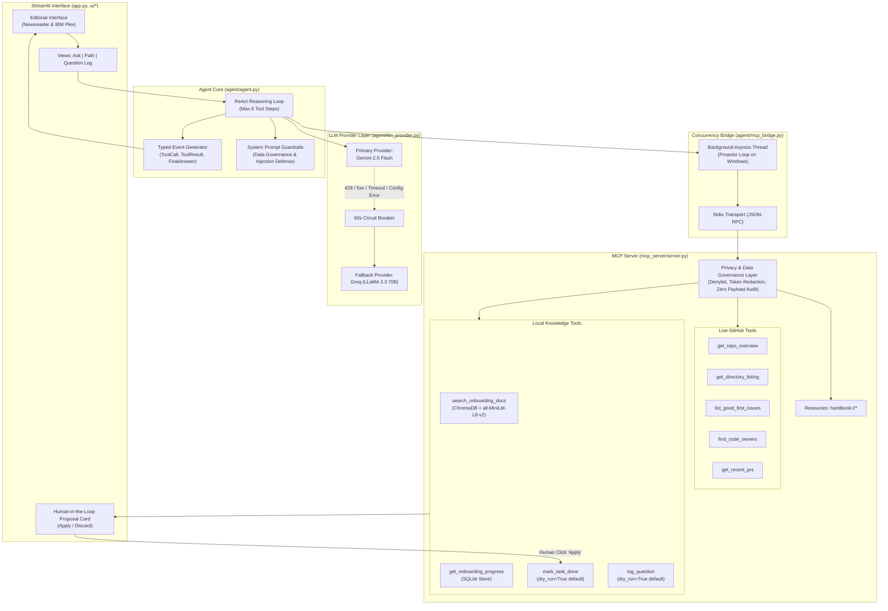

# Architecture and System Design

## Overview

The Onboarding assistant is an enterprise-grade, semi-autonomous AI system designed to accelerate engineer onboarding to large software repositories. It integrates a custom Model Context Protocol (MCP) server over standard input/output (stdio), a dual-provider LLM abstraction layer with automated failover, local semantic vector search over repository documentation, and an editorial human-in-the-loop user interface.

---

## Architectural Flow Diagram

---

## Component Breakdown

### 1. User Interface (`app.py`, `ui/`)
- Built using **Streamlit** styled to evoke a calm, editorial documentation site rather than a consumer chatbot.
- **Design Tokens**: Warm paper background (`#F7F5F0`), sidebar (`#EFEDE6`), dark slate ink (`#1B1B19`), forest green accent (`#2E5E4E`), and soft blue live chips (`#2B4C7E`).
- **Typography**: Editorial headings in **Newsreader**, body text in **IBM Plex Sans**, and tool metadata in **IBM Plex Mono**.
- **Human-in-the-Loop Cards**: Write operations generate an amber-tinted proposal card with **Apply** and **Discard** buttons. No database changes occur without explicit user interaction.

### 2. Semi-Autonomous ReAct Agent (`agent/agent.py`)
- Employs a single goal-based reasoning loop capped at 6 execution steps to eliminate runaway loops.
- Yields a live stream of typed events (`ToolCallEvent`, `ToolResultEvent`, `ProposalRequestedEvent`, `FinalAnswerEvent`).
- Strictly enforces parameter injection (`user_id`) and write-tool protection (`dry_run=True`).

### 3. Dual-Provider LLM Abstraction (`agent/llm_provider.py`)
- Implements a single provider-neutral `chat(messages, tools, system)` interface.
- **Primary**: Google Gemini 2.5 Flash via the official `google-genai` SDK with native tool declarations and custom timeout options.
- **Fallback**: Groq (LLaMA 3.3 70B Versatile) via OpenAI-compatible tool specifications.
- **Circuit Breaker**: Automatically trips on any Gemini 429 quota exhaustion, 5xx server error, or timeout, skipping Gemini for 60 seconds to avoid cascading latency.

### 4. Background Async Concurrency Bridge (`agent/mcp_bridge.py`)
- Bridges the synchronous Streamlit execution model with the asynchronous MCP client SDK.
- Runs a dedicated worker thread hosting an independent `asyncio` event loop configured with Windows `ProactorEventLoopPolicy`.
- Spawns and manages the MCP server subprocess once per application lifecycle, ensuring thread-safe JSON-RPC communication over standard I/O streams.

### 5. Custom MCP Server (`mcp_server/server.py`)
- Implemented using the official Model Context Protocol (MCP) Python SDK.
- Exposes 9 structured tools and URI-addressable handbook resources (`handbook://<relative/path>`).
- Enforces an all-encompassing **Privacy and Data Governance Layer** that prevents source code leaks, redacts authentication tokens, and maintains zero-payload cryptographic audit logs.

